# 低分辨率无人机机型识别中的视觉表示与监督适配评估

## 摘要

低分辨率无人机图像中的机身、旋翼与相机结构往往难以辨认，通用预训练能力能否迁移到这一细粒度识别场景，需要在固定数据协议下检验。本文构建含20,010张真实目标裁剪、12个作者类别的数据版本，并以保守场景和相似性约束组划分14,106张训练图像与5,904张测试图像。研究比较手工视觉表示、冻结SigLIP2表示，以及Qwen3-VL-2B的零样本、标准QLoRA和类别加权QLoRA，共13组模型设置。四类传统分类器分别为逻辑回归、K近邻、支持向量机和随机森林，选参在训练集内部的两折分组交叉验证中完成。手工特征调优KNN取得73.07%的测试准确率与61.08%的Macro-F1；Qwen标准适配由零样本的1.59%准确率提高到49.46%，但未超过传统基线。组件消融显示，类别加权未带来一致收益。逐类混淆、原生尺度分层与真实错误样例表明，平均分数不足以描述模型行为。测试仅覆盖8类，内部验证计分仅覆盖6类，来源组也未认证为独立飞行，因而结果用于当前协议下的经验诊断，不构成完整十二类外部泛化结论。数据获取、清洗代码与复现材料随文保留。

**关键词：** 无人机机型识别；小目标；视觉表示；QLoRA；消融实验；分组评价

项目代码仓库：https://github.com/fangdawei33/uav-type-classification-course-project

## 1 引言

无人机识别不仅需要区分飞行目标与背景，还可能需要辨别相似的具体机型。该任务依赖旋翼布局、机身比例、相机和支架等局部线索；当目标只占少量像素时，简单放大无法恢复已经丢失的信息。与此同时，公开图像常来自视频片段或重复转载，同一来源中的相邻帧会使按图片随机划分的评估过于乐观。模型能力、视觉证据与划分协议必须共同审视。

视觉语言预训练与参数高效适配为这一任务提供了可行工具，但“大模型更强”不等于在任意小样本、细粒度数据上都更准。本文不预设生成式模型胜出，而是提出三个可检验问题：RQ1，当前采集、标注与分组能支持多大范围的评价；RQ2，在相同分类器与划分下，冻结预训练表示相对手工表示有何差异；RQ3，监督适配及类别加权是否分别改善视觉语言模型的闭集标签预测。

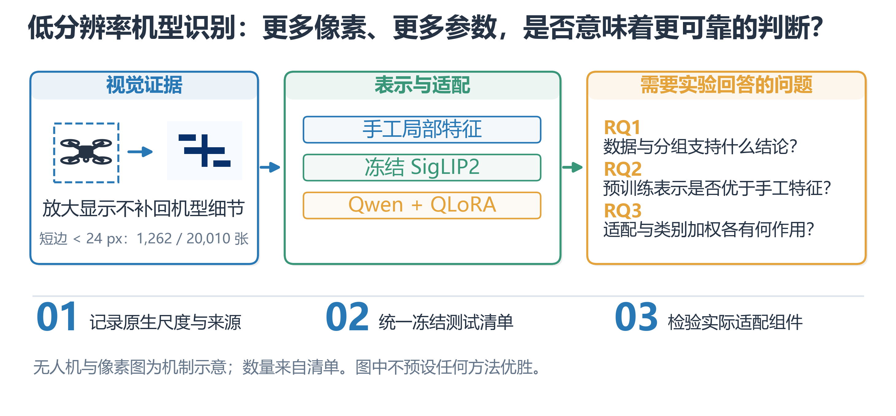

图1 研究动机与三个研究问题。无人机和像素块为机制示意，非测试样例；小目标数量来自本项目清单。图中不预设表示或适配策略优胜。

本文的主要工作体现在三个方面。首先，建立公开作者数据导入、自编网页爬虫、目标框校验、哈希溯源及原生尺度记录的完整数据流程，并明确自采弱标签与主监督样本的不同角色。其次，在同一冻结测试集上组织三类表示与适配路径，报告四类传统分类器和三种Qwen设置，而非只展示最优模型。最后，以配置开关消融、分类器固定的表示替换、参数搜索与错误案例解释失败模式，保留不支持预期的负结果。

这些贡献属于数据流程与经验评估；HOG、SigLIP2、LoRA与QLoRA均为已有方法。研究对象是作者标注框裁剪后的机型分类，不将已知目标框下的分类成绩写成端到端检测性能。网页标题与描述用于采集溯源，并未与图像形成真实飞行日志或传感器配对输入。

## 2 相关工作

### 2.1 无人机机型数据与细粒度识别

Drone-type-Set围绕无人机类型组织图像并提供目标检测研究基础[1]。本文使用其当前可访问作者子集，并将目标框转为分类输入；下载数量与论文名义数量的差异通过清单披露。对于相似机型，局部外观、视角及背景可能同时影响分类，数据来源和类别覆盖因此比单纯累计图片总数更值得关注。另一公开作者来源VisioDECT在项目来源索引[7]中登记；本实验遵循实际取得的图像和标签，不推断未提供的遥测信息。

### 2.2 预训练视觉表示与视觉语言模型

SigLIP2通过视觉语言预训练学习可迁移的图像表示[2]，为冻结特征提取加轻量分类器提供基础。与此不同，Qwen3-VL-2B-Instruct通过图像与文本指令生成答案[5]，闭集分类还需要将视觉判断映射到固定标签字符串。Tong等在MMVP中指出，多模态模型可能在特定视觉模式辨别上存在系统性短板[8]；这支持开展针对视觉证据的诊断，但其旧模型和不同任务上的结果不能直接解释本项目的Qwen表现。本文通过实测比较两种迁移路径，不用通用基准排名替代机型实验。

### 2.3 参数高效适配与研究定位

LoRA冻结预训练权重并学习低秩更新[3]；QLoRA进一步在量化基座上训练低秩适配参数[4]。本文在固定一轮预算下比较不适配、标准适配和类别加权适配，从输出偏置与类别表现分析后训练的作用。本文没有实现检索增强、强化学习或新的对比学习损失，因而不将这些概念写成方法组件。其研究问题是：在当前视觉质量与分组约束下，现有表示和适配手段实际解决了什么，又留下什么。

## 3 方法

### 3.1 任务定义与整体框架

设样本由目标裁剪图像I、作者机型标签y及约束组g组成，标签空间为0至11。约束组是根据场景与相似性构造的保守隔离单元，不等同于认证来源视频。训练集与测试集的样本和约束组均保持不相交：

<!-- equation:split:1 -->

$$
\mathcal D_{tr}\cap\mathcal D_{te}=\varnothing,\quad G_{tr}\cap G_{te}=\varnothing\tag{1}
$$

式中D表示样本集合，G表示其约束组集合。主训练集含14,106张图像，测试集含5,904张图像，种子为42，约为7∶3；组不可拆分使比例为70.495%与29.505%。三条路径分别使用手工特征、冻结SigLIP2和生成式Qwen，输出统一映射到十二个标签后在同一测试清单评价。模型、提示词和参数在测试前冻结。图2进一步区分前向路径、冻结模块、可训练适配参数与监督损失。

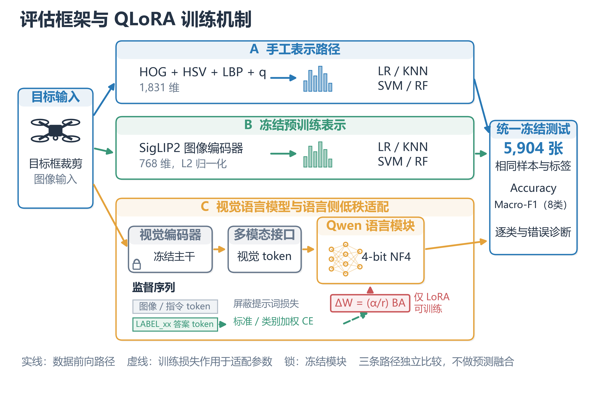

图2 整体评估框架与QLoRA训练机制。上方两条路径分别在手工与冻结表示上训练四类分类器；下方Qwen路径仅在语言侧注入LoRA。提示词位置不计算答案损失，标准与加权设置共用图像、提示词、基座和训练预算。多模态接口为基座已有结构，不是本项目新增融合模块。

### 3.2 数据准入与视觉证据保留

采集程序先检查robots和允许来源，再按文章正文选择器提取图片、图注与溯源字段，设置访问延时并保存快照；403或无法确认规则时停止该来源。作者数据经原图、标注和框边界核验后生成RGB裁剪。缺失标签或无效框不能用统计填补生成监督样本；数值特征若缺失，则仅在训练折内填补。

小图、暗图和低对比度保留质量标记，不在看到测试错误后删除困难样本。短边小于24像素的1,262张裁剪仍在主清单中，这意味着“已完成结构清洗”不等同于“每张图像都有足够机型信息”。网页自采材料缺少完整身份核验，未并入主监督训练或测试。完整采集、缺失统计、前后样例和代码见附录A。

### 3.3 手工视觉表示与冻结预训练表示

手工路径将图像缩放到128×128，提取1,764维HOG、54维HSV统计及直方图、10维uniform-LBP，以及亮度、对比度和原生宽高比3维统计量q。其拼接为：

<!-- equation:hand:2 -->

$$
x_H=[h_{HOG};h_{HSV};h_{LBP};q]\in\mathbb R^{1831}\tag{2}
$$

冻结预训练路径使用google/siglip2-base-patch16-224的图像编码器，并对768维输出执行L2归一化：

<!-- equation:siglip:3 -->

$$
x_S=\frac{f_\theta(I)}{\|f_\theta(I)\|_2}\in\mathbb R^{768},\quad\theta\text{ frozen}\tag{3}
$$

两种表示均分别输入逻辑回归、KNN、RBF-SVM和随机森林。除随机森林外，数值维度经训练折内中位数填补、常量方差筛选和标准化处理。对于保留的非零方差维度，标准化为：

<!-- equation:scale:4 -->

$$
z_j=\frac{x_j-\mu_{j,tr}}{\sigma_{j,tr}}\tag{4}
$$

均值μ与标准差σ只从当前训练折估计；来源名、文件名、URL与审核文本不进入特征矩阵。树模型依靠逐维阈值和排序分割，通常无需数值标准化。两条路径的差异是视觉表示，而不是将四个分类器做预测融合。

### 3.4 语言侧低秩监督适配

Qwen3-VL-2B-Instruct接收目标图像与十二个候选机型说明，按提示输出LABEL_00至LABEL_11中的一个标签字符串。字符串可能包含多个token，不把它误称为单个词元。基座以4-bit NF4存储，在语言侧q/k/v/o投影及gate/up/down投影注入低秩更新；视觉主干保持冻结。对一个适用线性层，实际计算权重可写为：

<!-- equation:lora:5 -->

$$
W'=W_{NF4}+\frac{\alpha}{r}BA,\quad r=8,\quad\alpha=16\tag{5}
$$

W_NF4表示量化基座恢复至计算精度后的冻结权重，A和B是可训练低秩矩阵；该式是已有QLoRA参数化，不是新算法。训练只监督assistant答案及编码器返回的对应结束位置。设A_i为样本i未被−100屏蔽的答案位置，样本损失为：

<!-- equation:answer:6 -->

$$
\ell_i=-\frac1{|A_i|}\sum_{t\in A_i}\log p_\phi(a_{i,t}\mid I_i,P,a_{i,<t})\tag{6}
$$

其中P为固定类别提示词，a_i,<t为当前位置之前的答案token，φ为加入适配器后的参数。图像与用户提示位置被屏蔽，不能仅因提示中包含标签说明就视为模型已学会分类。类别加权版本根据训练集计数n_c计算平方根逆频率，并在全体训练样本上归一化：

<!-- equation:weight:7 -->

$$
u_c=\sqrt{\frac{N}{Kn_c}},\quad w_c=\frac{u_c}{\sum_{d=0}^{K-1}(n_d/N)u_d}\tag{7}
$$

K=12，N=14,106。标准版本令所有权重为1，加权版本使用上述w_c；每个微批的目标为：

<!-- equation:objective:8 -->

$$
\mathcal L=\frac1B\sum_{i=1}^B w_{y_i}\ell_i,\quad w_c=1\text{ (standard)}\tag{8}
$$

全局归一化使训练样本平均权重为1。不能在大小为1的微批内再除以该批权重和，否则会把类别加权完全抵消。两版均训练1轮，学习率1×10⁻⁵、单卡微批1、梯度累积8、LoRA dropout 0.05、weight decay 0.01、warmup ratio 0.03，共1,764个优化步。未设独立验证集，也未按测试分数选检查点。

### 3.5 验证协议与评价指标

传统模型在训练集内执行两折分组交叉验证。为保留全部十二类训练样本，只有可分组验证的六类计分；其余只有一个训练约束组的类别始终留在训练折。测试有真实样本的类别集合为S_te={2,3,6,7,8,9,10,11}，而S_CV={2,7,8,9,10,11}。对支持集合S，Macro-F1定义为：

<!-- equation:macro:9 -->

$$
MacroF1(S)=\frac1{|S|}\sum_{c\in S}\frac{2P_cR_c}{P_c+R_c}\tag{9}
$$

P_c与R_c分别为类别精确率和召回率，分母为零时按实现置零。预测为不在测试真实支持集合内的其他标签仍会造成漏判，并未从准确率中剔除。Accuracy、平衡准确率和加权F1同时报告。网格搜索只最大化内部验证的平均分数：

<!-- equation:selection:10 -->

$$
\lambda^*=\arg\max_{\lambda\in\Lambda}\frac12\sum_{f=1}^2MacroF1(S_{CV};\lambda,f)\tag{10}
$$

λ是分类器超参数；两种表示各在基础四类模型中选出KNN后，搜索k∈{3,5,9,15}、投票权重∈{uniform,distance}，各8组、16次折内拟合，再在全部训练图像上重新拟合。CV与测试计分类别不同，不能直接把其分数差全部解释为过拟合；模型族与参数共用同一验证折，还存在非嵌套选择偏差。

## 4 实验与结果

### 4.1 数据与实验设置

原始获取总表含32,077张原图，其中包含角色不同的真实、弱标签和第三方合成材料；其总数不等于主训练集规模。主实验由原七类2,720张及新增五类17,290张真实裁剪组成。训练覆盖十二类，固定测试只覆盖八类。

表1 原始数据获取与使用角色

| 来源 | 原图数量 | 本实验角色 |
| --- | --- | --- |
| Drone-type-Set 作者目录 | 2973 | 审核后七类 2,720 张进入主数据 |
| VisioDECT 作者版本 | 20924 | 审核后五类 17,290 张进入主数据 |
| 自编公开网页爬虫 | 179 | 弱标签材料与身份参考，未参与主评估 |
| 第三方四类合成数据 | 8001 | 独立辅助实验，未合并主结果 |
| 原始总表 | 32077 | 包含不同角色，不能等同训练集规模 |

表2 类别与训练测试分布

| 标签 | 作者类别名 | 总数 | 训练集 | 测试集 | 约束组 |
| --- | --- | --- | --- | --- | --- |
| 0 | Bebop | 447 | 447 | 0 | 1 |
| 1 | DJI phantom 3 | 67 | 67 | 0 | 1 |
| 2 | DJI phantom 4 pro | 572 | 370 | 202 | 4 |
| 3 | Emax | 329 | 207 | 122 | 3 |
| 4 | Intel Aero RTF | 256 | 256 | 0 | 1 |
| 5 | Mambo | 578 | 578 | 0 | 1 |
| 6 | YH 19Hw | 471 | 396 | 75 | 2 |
| 7 | Anafi-Extended | 3371 | 2382 | 989 | 3 |
| 8 | DJIFPV | 3439 | 2327 | 1112 | 3 |
| 9 | EFT-E410S | 3552 | 2400 | 1152 | 3 |
| 10 | Mavic_Air | 3519 | 2356 | 1163 | 3 |
| 11 | Mavic_Enterprise | 3409 | 2320 | 1089 | 3 |
| 合计 | 12 个类别 | 20010 | 14106 | 5904 | 28 |

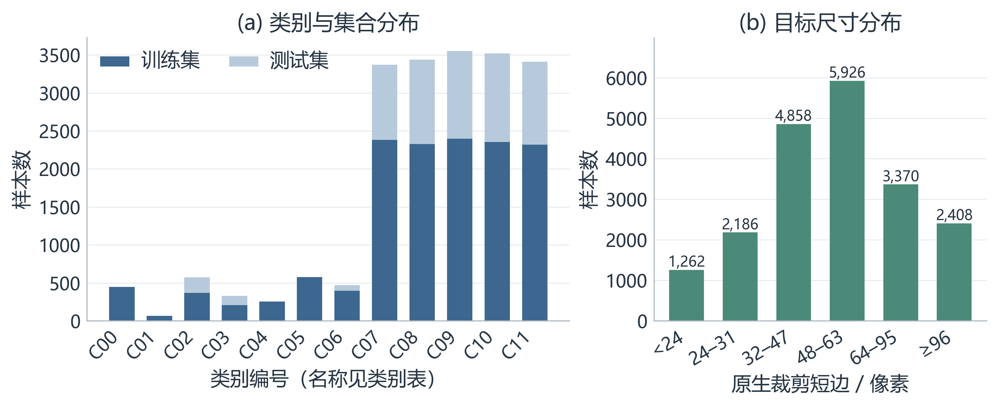

图3 主清单的类别、集合与原生尺度分布。训练与测试的类别支持不一致；互斥尺度区间反映模型实际获得的视觉证据。

主实验在Google Colab的NVIDIA A100-SXM4-40GB上完成，随机种子42；早期T4四类辅助实验不混入本结果。主要环境为Python 3.13.15、PyTorch 2.11.0+cu130、Transformers 4.57.1、scikit-learn 1.6.1。其余版本、运行入口和日志见附录E。四种基础分类器的具体参数见表3，内部两折分配见表4。

表3 传统模型基础参数

| 模型 | 关键参数 | 预处理与用途 |
| --- | --- | --- |
| 逻辑回归 | max_iter=3000；class_weight=balanced；seed=42 | 中位数填补＋去常量＋标准化 |
| KNN | n_neighbors=5；weights=uniform；p=2 | 中位数填补＋去常量＋标准化 |
| RBF-SVM | C=1；gamma=scale；class_weight=balanced；ovr | 中位数填补＋去常量＋标准化 |
| 随机森林 | 300 棵树；class_weight=balanced；n_jobs=1；seed=42 | 中位数填补＋去常量；不标准化 |

表4 训练集内部的两折分组验证

| 验证轮次 | 训练折样本 | 验证折样本 | 类别覆盖规则 |
| --- | --- | --- | --- |
| 1 | 7826 | 6280 | 6 类计分／12 类训练 |
| 2 | 8231 | 5875 | 6 类计分／12 类训练 |

### 4.2 主结果与公平比较

十三组设置评价相同5,904张冻结测试图像，按测试八类Macro-F1降序展示。十组传统结果由两种表示、各四个基础分类器和各一个调优结果组成；Qwen为零样本、标准和加权适配三组。调优后的SigLIP2-KNN是测试前由CV选出的传统参照，不能因手工KNN最终更高就改写成事前已选最优。Qwen标准适配同样为预先声明的主研究设置。

表5 十三组模型评价指标

| 表示与模型 | Accuracy | 平衡准确率 | Test-F1 | 加权 F1 | CV-F1 |
| --- | --- | --- | --- | --- | --- |
| 手工＋调优 KNN | 0.7307 | 0.5819 | 0.6108 | 0.7372 | 0.6255 |
| 手工＋KNN | 0.7276 | 0.5705 | 0.6029 | 0.7346 | 0.6152 |
| SigLIP2＋KNN | 0.5993 | 0.5928 | 0.5749 | 0.5832 | 0.8017 |
| SigLIP2＋调优 KNN | 0.5960 | 0.5885 | 0.5739 | 0.5784 | 0.8147 |
| 手工＋RBF-SVM | 0.6618 | 0.5712 | 0.5478 | 0.6662 | 0.6079 |
| SigLIP2＋逻辑回归 | 0.5908 | 0.6187 | 0.5452 | 0.5734 | 0.7928 |
| SigLIP2＋RBF-SVM | 0.5628 | 0.5739 | 0.5224 | 0.5420 | 0.7691 |
| 手工＋逻辑回归 | 0.6145 | 0.5263 | 0.5036 | 0.6248 | 0.5574 |
| SigLIP2＋随机森林 | 0.5108 | 0.4635 | 0.4420 | 0.4708 | 0.7930 |
| Qwen 加权 LoRA | 0.4804 | 0.3609 | 0.3670 | 0.4721 | — |
| Qwen 标准 LoRA | 0.4946 | 0.3645 | 0.3668 | 0.4841 | — |
| 手工＋随机森林 | 0.4314 | 0.3523 | 0.3147 | 0.3793 | 0.4871 |
| Qwen 零样本 | 0.0159 | 0.0582 | 0.0794 | 0.0217 | — |

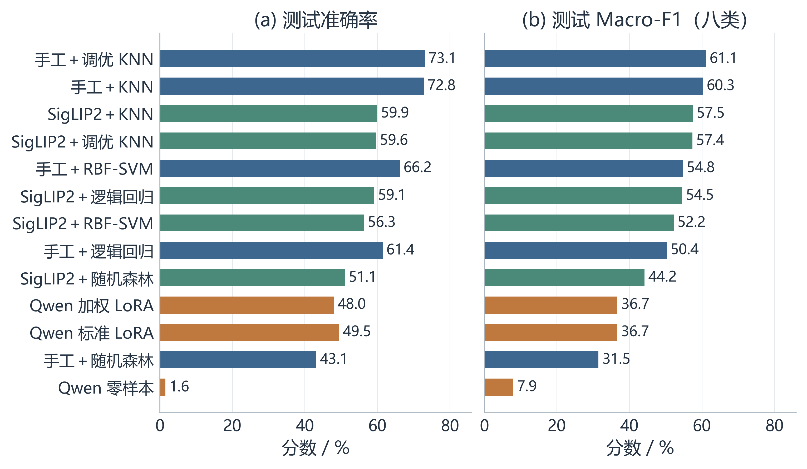

图4 相同测试清单上的总体性能。Accuracy与Macro-F1共享方法顺序；后者对八个真实支持类别等权平均。颜色对应表示家族，展示排序不参与模型选择。

手工调优KNN取得73.07%准确率和61.08% Macro-F1；标准QLoRA对应49.46%和36.68%。冻结SigLIP2并未在所有分类器上超过手工表示。这些结果支持按任务核验预训练迁移，不能泛化为手工方法普遍胜过大模型，也不能仅凭参数量解释优劣。

### 4.3 监督适配与类别加权消融

为回答RQ3，表6以组件开关组织已经执行的三组设置。图像输入、候选标签提示和冻结测试清单一致；标准与加权两次训练还共享基座revision、训练清单、代码哈希、优化器参数、LoRA位置与一轮预算。训练回执environment字段的差异仅为variant和balance_rule。消融A比较无适配与标准适配，检验加入监督训练的整体作用；消融B比较标准与加权适配，检验损失权重规则的边际作用。

表6 监督适配与类别加权组件消融 分数单位为百分数

| 设置 | 监督适配 | 全局类别权重 | Accuracy | Macro-F1 |
| --- | --- | --- | --- | --- |
| − 监督适配 | 关闭 | 关闭 | 1.59 | 7.94 |
| 标准设置 | 开启 | 关闭 | 49.46 | 36.68 |
| + 类别加权 | 开启 | 开启 | 48.04 | 36.70 |

加入标准监督适配后，准确率变化为+47.866个百分点，Macro-F1变化为+28.742个百分点；从标准到加权，准确率变化为-1.423个百分点，Macro-F1变化仅+0.022个百分点。后一个变化不支持整体改进，更不能把极小差值称为统计显著收益。

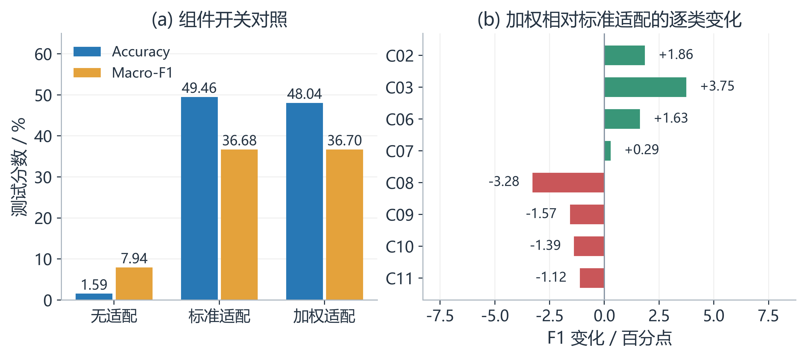

图5 适配组件消融。（a）已有三组配置的测试分数；（b）加权相对标准适配的逐类F1变化。总体微小变化伴随类别间得失，不是所有类别一致改善。

零样本有5,809/5,904张输出标签0，表现为标签输出偏置；标签0在测试中没有真实样本。监督适配显著改变了这一输出分布，但单次实验不能分离格式学习与视觉识别各自贡献。加权试图提高低频类的损失占比，却不增加其来源组数，也不会补回小图的视觉细节。当前没有多种子重复，故这组消融报告方向与观察值，不作机制因果或显著性保证。

### 4.4 分类器固定的视觉表示替换

为回答RQ2，图6固定基础分类器家族和参数，对比手工与冻结SigLIP2表示。输入维度、方差筛选后的特征空间及必要预处理随表示变化，因此它检验的是整条表示路径，不是HOG、颜色或纹理单个特征块的去除实验。

表7 相同分类器下的表示替换 对应测试Macro-F1

| 分类器 | 手工 / % | SigLIP2 / % | 变化 / 百分点 |
| --- | --- | --- | --- |
| 逻辑回归 | 50.36 | 54.52 | +4.16 |
| KNN | 60.29 | 57.49 | -2.80 |
| RBF-SVM | 54.78 | 52.24 | -2.54 |
| 随机森林 | 31.47 | 44.20 | +12.72 |

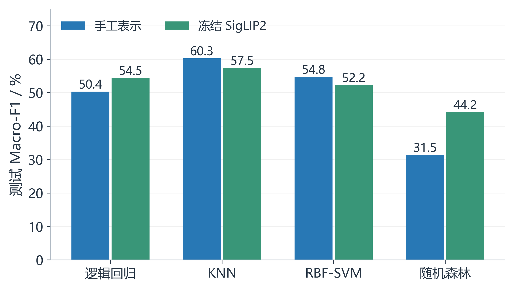

图6 固定基础分类器的视觉表示替换。四组对照沿用同一划分与模型参数；结果依赖表示和决策边界的组合，不能仅由表示规模排序。

### 4.5 参数搜索与训练过程

两条传统路径均在内部CV选中KNN，网格最优配置为k=3且距离加权。表8报告调优前后结果及两折波动，表9给出百分点变化。调优只使用训练集内部验证，最终测试变化作为冻结后的观察。

表8 KNN 调优前后指标

| 表示与阶段 | 邻居数／权重 | CV-F1 均值±标准差 | 测试准确率 | 测试 Macro-F1 |
| --- | --- | --- | --- | --- |
| 手工调优前 | 5／uniform | 0.6152 ± 0.0658 | 0.7276 | 0.6029 |
| 手工调优后 | 3／distance | 0.6255 ± 0.0455 | 0.7307 | 0.6108 |
| SigLIP2调优前 | 5／uniform | 0.8017 ± 0.0485 | 0.5993 | 0.5749 |
| SigLIP2调优后 | 3／distance | 0.8147 ± 0.0593 | 0.5960 | 0.5739 |

表9 调优后的指标变化 单位为百分点

| 表示 | CV-F1 变化 | 测试准确率变化 | 测试 Macro-F1 变化 |
| --- | --- | --- | --- |
| 手工 | +1.029 | +0.305 | +0.791 |
| SigLIP2 | +1.302 | -0.322 | -0.099 |

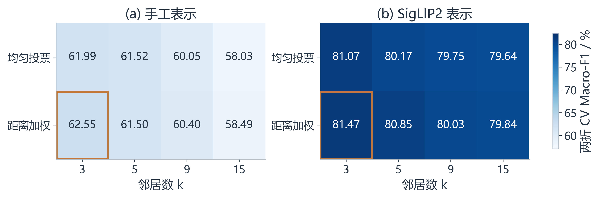

图7 KNN参数敏感性。色标为相同支持六类的两折平均验证Macro-F1；边框标记选中的组合，测试指标没有进入搜索。

手工KNN调优后测试有小幅提升，SigLIP2-KNN的CV分数上升而测试分数下降，说明内部最优并不保证测试收益。只有两折与一次划分，不能据此声称收益稳定。

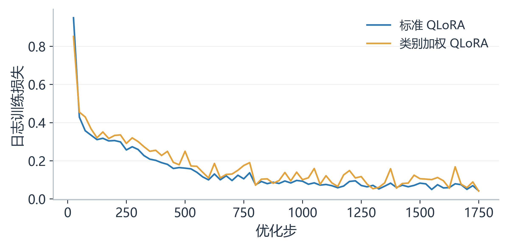

图8 标准与类别加权QLoRA的原始训练损失日志。仅显示实际记录的loss行，不将末尾摘要损失拼成新的训练点；两版目标权重不同，损失数值不能直接用来排名。

训练损失总体下降说明模型优化了各自训练目标，但没有独立验证曲线，不能凭曲线下降认定泛化提高。本文不补画不存在的验证轨迹，也不把标准与加权目标的绝对大小解释为模型能力差异。

## 5 分析与讨论

### 5.1 逐类表现与混淆结构

总体准确率被样本多的类别影响，Macro-F1又可能掩盖不同类别的失败形式。图9比较手工调优KNN与标准QLoRA，图10补充冻结SigLIP2的逐类F1。所有十二个预测标签和无效输出列保留，仅省略测试无真实样本的行；否则会隐去预测流向未支持类别的错误。

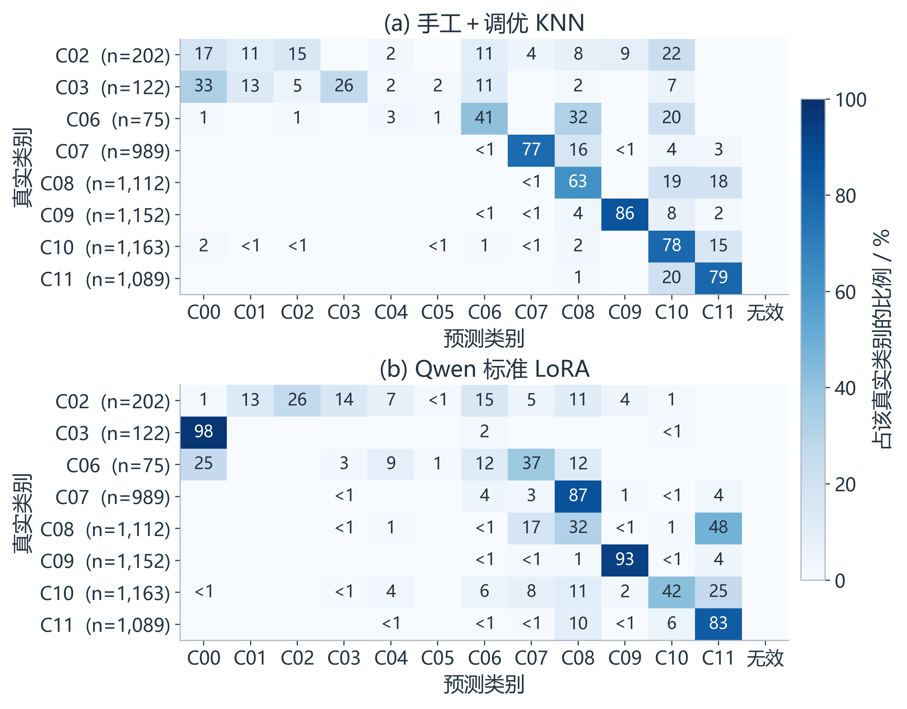

图9 两种代表模型的逐行归一化混淆矩阵。行标签含真实样本数；零项不标注，非零但低于1%的项标为＜1。C00至C11对应类别表中的标签0至11。

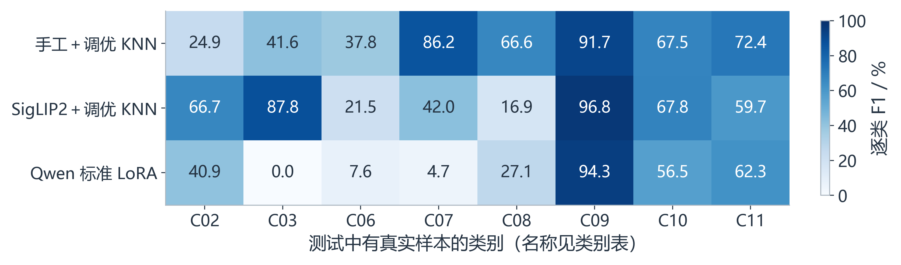

图10 代表设置的逐类F1。只显示有真实测试支持的八类；其他四类不能由零支持下的F1推断泛化表现。

手工调优 KNN 的测试准确率 0.7307、Macro-F1 0.6108 是本次观察的最佳结果。手工 KNN 高于线性模型，表明固定表示中的局部邻域对当前标签有用；RBF-SVM 提供非线性判别，但其基础参数没有获得相同测试优势。随机森林虽有集成机制，却在高维视觉描述子上取得较低测试成绩，不能仅凭“集成”名称保证更好效果。结果受表示、参数和来源分布共同影响，不能推导任一模型普遍优劣。

SigLIP2 的基础 KNN 训练内部 CV-F1 为 0.8017，而测试八类 F1 为 0.5749。口径统一到测试中的六个共同标签子集后，该 KNN 的 F1 为 0.5880，仍提示训练内部验证无法充分代表当前测试分布，但这是事后诊断且样本分布仍不同，不能精确分解数据域偏移和过拟合各自造成的损失。

Qwen 标准 LoRA 的准确率为 0.4946，零样本为 0.0159。零样本 5,809／5,904 张预测集中到标签 0，表现出明显输出偏置；这不等同于均匀随机猜测，不能仅由此认定全部数据标签错误。监督适配改善了标签格式与部分决策边界，但标准 LoRA 在 Anafi→DJIFPV、DJIFPV→Mavic_Enterprise 等类别上仍有大量混淆。其 EFT-E410S 召回率为 0.9340、精确率为 0.9522，二者不应混写。加权 LoRA 的 Macro-F1 约 0.3670，准确率低于标准版本，没有形成整体改善。

可能影响 Qwen 表现的因素包括冻结视觉主干、语言侧低秩适配、单轮预算、闭集标签字符串学习、小目标放大与来源偏差。这些是与配置一致的待验证解释，并非已通过消融证实的因果结论。模型参数多并不保证细粒度、小尺度分类一定占优。

### 5.2 定性样例与视觉证据

图11来自已保存的标准QLoRA逐图预测。样例按预先写入绘图代码的“指定类别×正确性分层，取保存顺序中首项”规则选择：类别2的首个正确与错误、类别7和8的首个错误、类别9的首个正确，以及类别10的首个错误。该选择规则只服务解释，不构成无偏错误率估计，完整sample_id与图像哈希另存于qualitative_cases.csv。

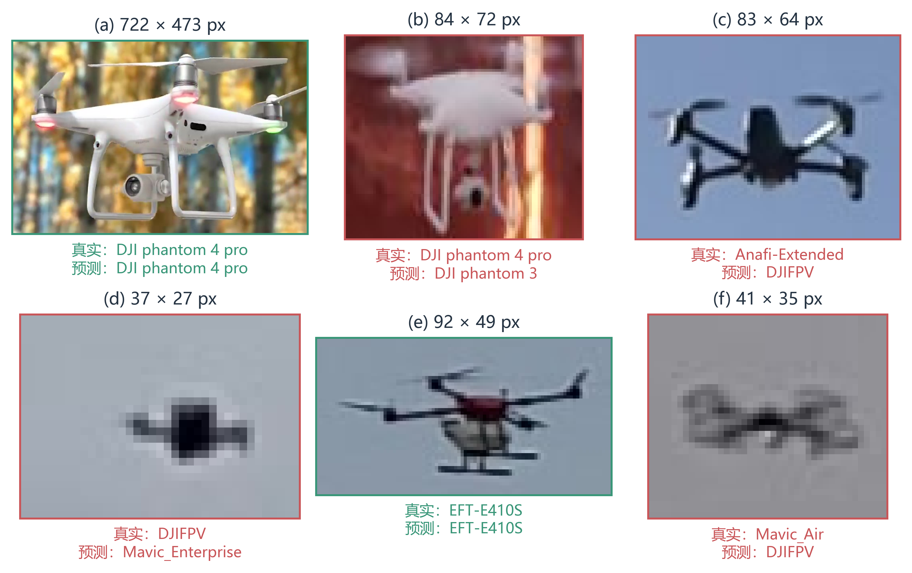

图11 真实测试裁剪与标准QLoRA预测。标题为原生图像尺寸，绿色和红色边框分别表示正确与错误；展示采用最近邻放大，不进行细节生成。来源为Drone-type-Set作者子集及VisioDECT作者图像，样本溯源见随图CSV。

这些样例帮助观察外观、视角与像素证据，但不能替代全量身份审核。错误类别之间可能存在局部结构相近、背景影响或样本来源相关性；未运行注意力或因果干预分析时，不能把某个可见区域断言为模型的真实决策依据。

### 5.3 特征解释与来源影响

随机森林中 lbp_0、lbp_9、saturation_mean、hue_mean 等特征排名靠前，说明该模型利用了纹理、色彩与饱和度统计。这既可能包含机体外观信息，也可能编码背景与成像条件。相关特征会分摊重要性，基于不纯度的重要性不提供因果解释；不能将其写成“色彩决定机型”。应通过独立背景、更严格来源隔离和适当的解释方法继续核对。

误差还可能来自作者标签的商品子型未独立核实、相近型号形态相似、连续帧相关、部分框的目标比例低、图像压缩或遮挡，以及未认证来源组。爬虫弱标签没有混入主训练，避免引入未经确认的噪声，但也意味着本次没有验证“公开训练、自采外部测试”的研究设想。

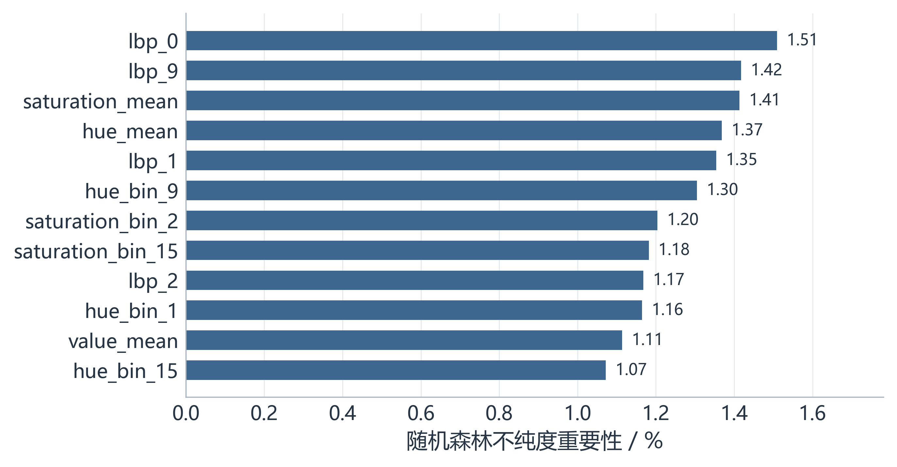

图12 手工特征随机森林的前十二项不纯度重要性。该解释仅对应随机森林；相关特征可能分摊重要性，不能据此解释KNN或Qwen，也不提供因果关系。

### 5.4 原生目标尺度与误差分层

依据清洗清单的原生裁剪宽高计算，短边中位数为 51 像素，最小为 8、最大为 720。以下阈值是累计统计，行之间不可相加。


短边小于 24 的 1,262 张占 6.31%，小于 32 的 3,448 张占 17.23%。这回应了部分目标很小、肉眼难辨的问题，说明“清洗后”不能等同于“每张均适合细粒度机型鉴别”。尺寸只是审核线索，不存在对所有机型通用的自动可辨阈值。当前结果保留这些样本，没有执行去除后重训，也没有通过尺度消融证明低分主要由小图造成。后续需在训练阶段预定可辨认性规则，保留困难测试样本单独报告；不能在看到测试错误后删掉难例，再把新高分与旧协议直接比较。

进一步将已保存的逐图预测按原生短边分为＜24、24至31、32至47、48至63、64至95、≥96像素的互斥区间。图13显示各区间准确率与支持数，明细保存于 research_figures/scale_diagnostics.csv。标准 LoRA 在短边＜24像素的332张测试图上准确率为8.43%，在48至63像素的1,385张上为75.31%，但在≥96像素的598张上又降至33.61%，并不呈单调关系。此分析没有重新推理、筛除测试图或拟合新参数。各区间的类别和来源组成不同，曲线差异不能解释为单纯提高分辨率即可获得的性能增益，也不是控制变量的尺度消融。

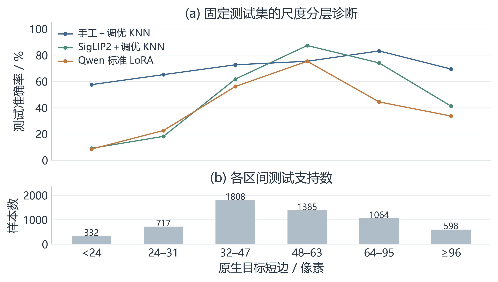

图13 固定测试结果的原生尺度分层。上方为三种代表设置的准确率，下方为各区间支持数；类别和来源组成随区间变化，此图为事后描述，不是控制变量的尺度消融。

### 5.5 过拟合与证据边界

表10 传统模型训练与测试准确率

| 表示与模型 | 训练准确率 | 测试准确率 |
| --- | --- | --- |
| 手工＋逻辑回归 | 1.0000 | 0.6145 |
| 手工＋KNN | 0.9687 | 0.7276 |
| 手工＋RBF-SVM | 0.9988 | 0.6618 |
| 手工＋随机森林 | 1.0000 | 0.4314 |
| 手工＋调优 KNN | 1.0000 | 0.7307 |
| SigLIP2＋逻辑回归 | 1.0000 | 0.5908 |
| SigLIP2＋KNN | 0.9974 | 0.5993 |
| SigLIP2＋RBF-SVM | 0.9995 | 0.5628 |
| SigLIP2＋随机森林 | 1.0000 | 0.5108 |
| SigLIP2＋调优 KNN | 1.0000 | 0.5960 |

多个模型训练准确率接近 1，而测试明显较低，提示记忆训练样本、相关帧、来源分布差异或模型容量等问题需要排查。距离加权 KNN 在本训练点上预测会包含该点自身，训练准确率为 1 并不单独证明数据泄露；应结合组间验证与独立测试判断。Qwen 本次没有逐轮验证曲线，不能仅凭训练损失下降判断泛化改善，也不能确定单轮结果属于纯粹欠拟合。

可执行的后续方案包括收集每类多个可核实来源、在训练组内固定验证方案、使用正则化和可验证的早停、增加真实而有身份依据的训练样本，及开展目标尺度与视觉适配消融。本报告只提出这些方案，不将它们列为已实施的性能提升。

当前实测消融覆盖监督适配与类别加权；固定分类器的表示替换是另一组受控比较。HOG/HSV/LBP特征块去除、视觉主干解冻、LoRA秩与训练轮数敏感性、尺度筛选后重训及独立来源测试仍待开展。现有测试已用于结果分析，后续方法选择应另行登记，并使用新的独立测试数据验证。

测试覆盖八类、内部CV计分六类、约束组未经独立飞行认证，以及Qwen无独立验证集，限制了结论的外推。各适配设置只有单次运行，尚不能估计训练随机性引起的方差或置信区间。自采弱标签未进入主监督评价，公开数据训练到自采数据外部测试的泛化能力仍待验证。

## 6 结论

本文以低分辨率无人机机型分类为对象，建立可追溯数据流程，并在固定分组协议下评估手工表示、冻结视觉语言表示和生成式模型监督适配。当前结果中，手工调优KNN优于所比较的预训练与适配路径；标准QLoRA相对零样本有明显改善，类别加权却没有形成一致收益。模型比较、适配消融和定性诊断共同说明，视觉证据、来源覆盖与监督目标需要分开检验，通用预训练规模不能直接替代任务验证。

下一步应优先补充每类多个可核实独立来源，改善固定验证与测试支持，再开展视觉侧适配和特征块消融。现有结论限定于本次数据版本与测试支持类别，不宣称新的算法突破或完整十二类外部泛化。课程要求的实现过程、关键代码、真实问题、四道思考题与心得体会保留在以下附录。

## 附录A 数据采集与预处理过程

### A.1 数据获取与爬虫设计

采集分为作者公开数据导入和自编网页爬虫两条路径。Drone-type-Set 公开目录实际取得 2,973 张原图及同名标注；VisioDECT 作者版本编目 20,924 张图像。程序只登记实际可取得的文件，不将论文中更大的名义数量作为已下载数量。第三方四类合成原图 8,001 张作为独立辅助材料。网页爬虫最终取得 179 张原图；其中清洗后的 135 张弱标签目标裁剪与 4 张身份参考单独交付，没有进入本次主监督训练和测试。早期日志中的 171 是采集过程快照，最终数量以交付回执为准。


文章爬虫读取配置中的来源 URL、允许主机、正文选择器、标题关键词和候选类别。先检查 robots，再按请求间隔访问正文；保存 HTML 快照后提取 img 的 src、srcset、alt 和上下文图注，保留页面实际出现的链接。下载阶段只处理明确选中的媒体，记录原始字节哈希、时间和许可状态。Commons 采集器同时登记文件页、作者与许可信息。访问失败、标题不符、无效图片和未知许可分别记录，不依靠破解反爬获取数据。

原始 CSV 包含 sample_id、source_url、download_url、collected_at、sha256、candidate_label、title、description、caption、width、height、group_id、license_review 等字段。其中 ID 与哈希用于溯源，尺寸用于质量诊断，标签与分组需审核，标题和描述属于混杂文本，不能直接当数值送入模型。


来源：文章样例来自 https://www.halfchrome.com/tello-vs-mambo/；原始 CSV 为 data/metadata/drone_type_article_raw.csv 和 drone_type_external_raw.csv。此处展示采集时记录，后续审核状态保存在独立决策表，不伪装为原始字段已自动确认。

代码1 robots 检查后的请求入口与文章正文解析节选

```python
# src/uav_project/http_client.py 的 Web.get
def get(self, url, max_bytes=25_000_000):
    self.allowed(url)
    return self.raw(url, max_bytes)
```

```python
containers = soup.select(source['content_selector'])
if not containers:
    raise ValueError('Configured article-content selector found no content; preserve HTML: ' + snapshot)
title_node = soup.select_one(source.get('title_selector', 'h1'))
title = title_node.get_text(' ', strip=True) if title_node else ''
```

allowed 方法核验 HTTPS、来源白名单与 robots；raw 方法执行延时、重定向复核、流式大小上限和最多三次请求尝试。文章配置请求间隔为 2 秒，若站点给出更长 crawl-delay 则采用更长间隔。403 或无法确认 robots 时停止对应来源；原始下载重试和网页解析代码均保留在仓库。

表11 自采集原始记录示例

| 字段 | 文章样例 | Commons 样例 |
| --- | --- | --- |
| sample_id | dta_4feae19ca5e40e4d044f | dte_e979f5fddecf1e4d92c4 |
| 候选类别／原图尺寸 | Mambo／1024×580 | Bebop／816×538 |
| 网页标题 | Ryze Tello vs Parrot Mambo: Which is the Best Micro Drone? | File: Bebop Drone authorized flight over Paris Air Show.jpg |
| 图像文本线索 | Top angle view of Parrot Mambo | Parrot drone over Le Bourget Air Show |
| 原始审核与许可状态 | 候选待审／许可未核验 | 候选待审／文件页记载 CC BY-SA 4.0 |

### A.2 缺失 异常 文本与裁剪处理

缺失值按字段职责处理。缺失目标标签、缺失目标框或解码失败不能自动生成监督样本；保留为待审核或排除记录。group_id 不完整时不将未知图片随机分配到不同集合。标题、描述或许可字段为空时保持来源不确定性，禁止把空许可视为允许再分发。主实验清洗表的 width、height、gray_mean、gray_std、laplacian_variance_128 在训练集中的缺失数均为 0。target_short_side_pixels 属于早期来源的可选字段，并非所有来源填写；统一从实际裁剪宽高重新计算短边。

表12 训练集质量字段缺失统计

| 数值字段 | 样本数 | 缺失数 |
| --- | --- | --- |
| width | 14106 | 0 |
| height | 14106 | 0 |
| gray_mean | 14106 | 0 |
| gray_std | 14106 | 0 |
| laplacian_variance_128 | 14106 | 0 |

清洗先核验原图字节哈希，将目标框的逗号分隔文本解析为四个有限浮点数，检查坐标方向、边界和面积，再按左上取 floor、右下取 ceil 生成 RGB 原生尺寸裁剪；保存后检查尺寸与像素一致性。对已存在的早期裁剪同时核对哈希和 RGB 像素，防止读取到不同版本。EXIF 方向不为 1 时停止该记录并要求核对坐标，而非盲目旋转后沿用旧框。

原七类排除 253 项，记录的原因包括烧录检测框与置信度、标题卡、字幕、画中画、错框、转场叠影及机身出画。扩展候选共 20,018 张，另排除 8 张无法辨认目标的裁剪，形成 20,010 张主清单。两次排除处于不同阶段，不应重复计数。文件夹仍可能保留历史排除文件，训练必须按清单读取。

文本处理采用 BeautifulSoup 提取正文与去除 HTML 标签，统一空白；类名通过固定映射转换为整数 y，框坐标解析为数值。标题、文件名、来源 ID 与网页描述不进入 X，防止模型从元数据猜标签。没有匹配的飞行日志，不编造飞行速度或传感器数值填充表格。

表13 原始图像与清洗裁剪对比

| 类别 | 原始尺寸 | 目标框 xyxy | 清洗尺寸 | 处理结果 |
| --- | --- | --- | --- | --- |
| Bebop | 1280×720 | 269,212,1108,672 | 839×460 | RGB 裁剪，像素核验 |
| Bebop | 1280×720 | 3,12,1280,519 | 1277×507 | RGB 裁剪，像素核验 |
| DJI phantom 4 pro | 416×416 | 177,222,192,241 | 15×19 | 短边小于 24，保留质量标记 |

代码2 目标框文本解析与裁剪核心代码

```python
values = tuple(float(v) for v in item['target_box_xyxy'].split(','))
if len(values) != 4 or not all(math.isfinite(v) for v in values):
    raise ValueError('Invalid box: ' + item['sample_id'])
x1, y1, x2, y2 = values
if not (0 <= x1 < x2 <= size[0] and 0 <= y1 < y2 <= size[1]):
    raise ValueError('Out-of-bounds box: ' + item['sample_id'])
rect = (math.floor(x1), math.floor(y1), math.ceil(x2), math.ceil(y2))
rgb = source.convert('RGB')
crop = rgb.crop(rect)
```

对短边小于 24 像素的样本，当前代码添加 short_side_below_24 标记，没有自动删除。低对比度和大面积暗区也仅触发质量提示。质量标记不代表已完成专家逐图审核；本实验未执行全量可辨认性复核或按尺度筛选后重新训练。

### A.3 特征工程与相关性记录

手工路径将裁剪转换到 128×128 计算特征，同时保留原生宽高比。HSV 三通道各含均值、标准差和 16 桶直方图，共 54 维；HOG 采用 9 个方向、16×16 像素单元、2×2 单元块，共 1,764 维；LBP 采用 8 邻点、半径 1、uniform 模式，共 10 维；灰度均值、灰度标准差和宽高比共 3 维。合计 1,831 维。

SigLIP2[2,6] 使用 google/siglip2-base-patch16-224 的冻结图像编码器，输出 768 维向量并进行 L2 归一化，模型 revision、处理器和推理精度在特征回执中固定。原生低分辨率图像即使被放大，也无法恢复真实机身细节。

标签采用固定的 0 至 11 整数编码，标签数值不表示大小或距离。输入不包含类别型表格特征，因此没有必要额外对机型标签做独热编码作为 X；监督目标 y 与输入 X 分开保存。文件名、URL、哈希、来源组与人工审核字段仅用于数据管理。训练集全量 X 的形状分别为 14,106×1,831 和 14,106×768，经过折内常量特征筛选后维数以相应模型的支持掩码为准。

代码3 折内填补 方差筛选与标准化流水线

```python
def pipe(model, scale=True):
    steps = [("impute", SimpleImputer(strategy="median")),
             ("variance", VarianceThreshold())]
    if scale:
        steps.append(("scale", StandardScaler()))
    return Pipeline(steps + [("model", model)])
```

该 Pipeline 在交叉验证时由每个训练折独立拟合；随机森林设置 scale=False，其他三类模型执行 StandardScaler。VarianceThreshold 使用默认阈值 0，只排除训练折内常量维度，不声称已通过相关性阈值删除全部冗余特征。

报告补充对已保存训练清单中质量字段的 Pearson 相关性分析：宽度与高度相关较高，宽高也与统一尺度下的拉普拉斯方差相关，提示目标尺度、构图和清晰度统计并非完全独立。此项为结果解释，不参与本次模型选择，也不把质量字段之间的相关性等同于 1,831 维全部特征的相关性。

表14 训练集部分质量字段相关系数

| 字段组合 | Pearson r |
| --- | --- |
| 宽度与高度 | 0.9423 |
| 宽度与拉普拉斯方差 | 0.8502 |
| 高度与拉普拉斯方差 | 0.8505 |

## 附录B 数据划分 模型与评价关键代码

### B.1 训练 验证 测试与泄露控制

常见三类数据角色是：训练集拟合模型，验证集选择参数或检查点，测试集评价最终固定方案。本实验采用训练集内部交叉验证，因此不要求另存一份固定验证集。原代码把可用于训练和调参的 14,106 张称为 development，把保留到最后评价的 5,904 张称为 holdout。本报告统一称为训练集与测试集；为保持历史清单和哈希不变，CSV 与源码中的原英文取值保留，对应关系在附录说明。

按预先构造的场景与相似性约束组整体划分，以接近 30% 测试量为目标，最终训练／测试占比为 70.495%／29.505%，种子为 42。整组不可拆分，所以不是严格逐样本随机 7∶3。训练与测试的 group_id 集合无交集，但这些约束组尚未认证为真实独立飞行或独立拍摄来源，不能把组不重叠写成已证明外部独立。


验证折只对标签 2、7、8、9、10、11 共 6 类计算 Macro-F1，其余 6 类因训练集内只有一个约束组，始终留在每轮训练折中；各训练折仍包含全部 12 个标签。因此这是带有始终训练样本的两折分组验证，不能说每张样本都轮流做过验证，也不能把验证分数称为完整十二类交叉验证成绩。传统模型选参结束后在全部 14,106 张训练样本上重新拟合。

Qwen 两个 LoRA 版本都在全部训练集上按预设参数训练一轮，没有另设固定验证集，没有验证损失选检查点或验证早停。测试集在模型、参数、提示词与协议冻结后评价，未用于这次选参。没有独立验证集是本次大模型实验的局限，不能在报告阶段补写成做过三集划分。未来如需早停或比较更多 LoRA 方案，应先在训练组内设定验证组，再用新的独立测试版本评价。


代码4 按组构造训练折与验证折节选

```python
for fold in protocol["folds"]:
    validation_groups = set(fold["validation_group_ids"])
    val_mask = development.group_id.isin(validation_groups).to_numpy()
    train_idx, val_idx = np.flatnonzero(~val_mask), np.flatnonzero(val_mask)
    if not len(train_idx) or not len(val_idx):
        raise ValueError(f"Empty group CV fold {fold['fold']}")
    train_groups = set(development.iloc[train_idx].group_id)
    val_groups = set(development.iloc[val_idx].group_id)
    if train_groups & val_groups or set(development.iloc[train_idx].label) != set(range(12)):
        raise ValueError(f"Group leak or missing training labels in fold {fold['fold']}")
```

泄露防护包括：相关样本整体分组，训练折内拟合预处理器，测试特征只在最终评价阶段生成；超参数依据训练内部验证分数；固定数据清单、代码哈希、模型与提示词；续跑时核验同一冻结版本和预测前缀。中断后恢复已冻结测试推理不等于重新调参。测试成绩已经公开后，再根据错误案例优化方法，应视为新实验并使用新独立测试数据。

### B.2 多模型实现

逻辑回归以线性类别得分和概率损失学习边界；KNN按特征距离选邻居并投票；RBF-SVM以核映射学习非线性间隔，C控制正则化而gamma控制局部影响；随机森林对随机化决策树进行集成，能表达非线性交互并提供不纯度重要性。四者分别代表线性、邻域、核和树集成原理，均由训练样本建立决策规则。

两种表示各训练四个基础分类器，分别构成八组传统基线；每种表示再对验证最优的模型族执行一次网格搜索，形成两组调优结果。Qwen 零样本、标准 LoRA 与加权 LoRA 共三组，合计十三组。模型使用相同主数据版本和测试样本，不将早期合成集的高准确率放到本表比较。


代码5 基础模型的交叉验证与最终训练节选

```python
scores = cross_val_score(estimator, X, y, cv=cv, scoring=scorer, n_jobs=jobs, error_score="raise")
estimator.fit(X, y)
joblib.dump(estimator, model_path, compress=3)
train_report = classification_report(y, estimator.predict(X), labels=list(range(12)),
    target_names=protocol["classes"], output_dict=True, zero_division=0)
```

Qwen 采用 4-bit NF4、float16，图像像素范围 50,176 至 150,528，输入最大长度 1,024，最多生成 8 个新 token；LoRA r=8、alpha=16、dropout=0.05，学习率 1×10⁻⁵，weight_decay=0.01，warmup_ratio=0.03。每设备 batch=1，梯度累积 8，启用梯度检查点；每个版本训练 1 epoch，回执记录各 1,764 个优化步。适配目标为语言侧 q_proj、k_proj、v_proj、o_proj、gate_proj、up_proj、down_proj，视觉模块不训练。两个版本只在预先声明的样本损失权重上不同，并非训练后依测试集选择加权方案。

### B.3 指标与网格搜索实现

Accuracy为全部测试样本预测正确的比例；平衡准确率为实际出现类别召回率的均值；Weighted-F1按真实样本数加权各类F1。Macro-F1对支持集合内的类别等权平均，因而更关注低频类别；所有指标必须与对应支持集合共同解释。

先在相同训练内分组折上按支持六类的平均 Macro-F1 选择模型族。两种表示实际选中 KNN，随后只搜索 n_neighbors∈{3,5,9,15}、weights∈{uniform,distance}，共 8 组参数，每种表示执行 16 次验证拟合，再以最佳参数全训练集 refit。两者均选中 n_neighbors=3、weights=distance。源码为其他分类器保留的参数网格不代表本次也全部执行过。

代码6 网格搜索实现节选

```python
grid = GridSearchCV(candidates[selected], grids[selected], cv=cv, scoring=scorer,
                    n_jobs=jobs, refit=True, error_score="raise", return_train_score=True)
grid.fit(X, y)
```

scorer 使用 f1_score 的 labels=[2,7,8,9,10,11]、average='macro' 和 zero_division=0。模型族选择和调参共用同一组验证折，没有嵌套交叉验证，最优验证分数可能偏乐观。预先按交叉验证选中的传统模型是 SigLIP2＋调优 KNN；最终测试中手工特征更好属于观察结果，不能倒过来声称它在测试前已被选为最优。主研究方法 Qwen 标准 LoRA 是预先声明的方法，不因测试低分改名替换。

最终测试有真实样本的类别为 2、3、6、7、8、9、10、11 共 8 类，正文 Macro-F1 明确对这八类计分，另保存全十二标签口径。预测成测试中没有真实样本的类别仍会造成真类漏判，未从准确率中删除。缺失的四类测试支持数为 0，不能用把它们的 F1 设零来证明这些类别的真实泛化能力。

代码7 测试指标的实际实现节选

```python
supported_macro = float(f1_score(truth, prediction, labels=present, average="macro", zero_division=0))
return {"samples": int(len(frame)), "labels_present": present,
    "class_names_present": [protocol["classes"][index] for index in present],
    "accuracy": float(accuracy_score(truth, prediction)),
    "balanced_accuracy_present_labels": float(balanced_accuracy_score(truth, prediction)),
    "macro_f1_supported_labels": supported_macro,
    "macro_f1_all_12_labels": float(f1_score(truth, prediction, labels=all_labels,
                                              average="macro", zero_division=0)),
    "weighted_f1": float(f1_score(truth, prediction, labels=all_labels,
                                   average="weighted", zero_division=0)),
    "invalid_prediction_rate": invalid,
    "classification_report": report,
    "confusion_matrix_all_12": confusion_matrix(truth, prediction, labels=all_labels).tolist(),
    "confusion_matrix_with_invalid": confusion_matrix(truth, prediction, labels=all_labels + [-1]).tolist()}
```

### B.4 预测与统计补充

表15 标准 LoRA 真实与预测标签样例

| 样例编号 | 真实类别 | 预测类别 | 判定 |
| --- | --- | --- | --- |
| P01 | DJI phantom 4 pro | DJI phantom 4 pro | 正确 |
| P02 | DJI phantom 4 pro | DJI phantom 3 | 错误 |
| P03 | Anafi-Extended | Anafi-Extended | 正确 |
| P04 | Anafi-Extended | DJIFPV | 错误 |
| P05 | DJIFPV | DJIFPV | 正确 |
| P06 | DJIFPV | Mavic_Enterprise | 错误 |
| P07 | EFT-E410S | EFT-E410S | 正确 |
| P08 | EFT-E410S | DJIFPV | 错误 |

表16 手工特征随机森林的前六项重要性

| 特征名 | 不纯度重要性 |
| --- | --- |
| lbp_0 | 0.015097 |
| lbp_9 | 0.014172 |
| saturation_mean | 0.014135 |
| hue_mean | 0.013685 |
| lbp_1 | 0.013544 |
| hue_bin_9 | 0.013046 |

表17 原生目标裁剪短边统计

| 短边条件 | 样本数 | 占 20,010 张比例 |
| --- | --- | --- |
| 小于 12 像素 | 57 | 0.28% |
| 小于 16 像素 | 272 | 1.36% |
| 小于 24 像素 | 1262 | 6.31% |
| 小于 32 像素 | 3448 | 17.23% |
| 小于 48 像素 | 8306 | 41.51% |
| 小于 64 像素 | 14232 | 71.12% |

## 附录C 实验问题与解决方法

公开目录数量与论文名义数量不一致。七类目录实际取得 2,973 对，而非预设每类 1,000 对；初版程序因此停止。之后将实际清单与数量差异登记，按可访问子集处理，没有虚构缺少图片或把部分目录写成完整论文数据。

小文件批量下载缓慢，gdown 出现 Cannot retrieve the public link 报错。后续由浏览器下载公开目录压缩包，使用 ZIP 导入脚本核对文件和标注；这解决取得公开原始文件的路径问题，独立网页爬虫仍按来源规则执行，不用手动下载冒充自编爬虫。

部分网页返回 403 或无法取得 robots。采集器停止对应来源，记录请求、错误与 HTML 快照，再处理允许访问的其他来源；未绕过访问控制。公开网页图片的许可和类别身份并不随下载成功自动确认，相关候选保持弱标签角色。

结果整理中出现清单字段名 partition 与真实 split 不一致的问题，导致字段访问异常。按真实表头修正读取逻辑，并固定后续数据格式；缺失目标框或候选字段不匹配时回到原记录核对，禁止补造目标框以使代码运行。

Colab 测试推理续跑时，进度 JSON 声明已完成 3,250 或 4,500 张，但本地 evaluation 目录缺少对应预测前缀 CSV，触发 FileNotFoundError。恢复步骤依据 Drive 中已保存的最新前缀与 SHA-256，将 CSV 放回期望目录后继续同一冻结版本；最终返回三组 Qwen 各 5,904 条预测。恢复进度不应仅信任 completed_samples 数值，必须同时核验文件存在、哈希、样本顺序与冻结版本。

零样本大量输出同一标签。报告保留该失败结果与微调对比，未用规则改写预测来提高分数。小尺寸目标和缺少四类独立测试样本仍未解决，明确写入限制。报告复核还纠正了基础 KNN 与调优 KNN 的 CV 分数混用，以及将 EFT 类精确率误写成召回率的问题；以原始 JSON 与逐图预测为准。

## 附录D 课程思考题作答

### D.1 真实爬虫数据有哪些噪声及不预处理的后果

噪声包括缺失文本、标题与图片不符、重复或相邻帧、损坏图、格式差异、错误框、目标出画、字幕、检测框烧录与来源标签错误。网页还可能含宣传图、渲染图或身份未确认的相似产品。跳过预处理会造成读取异常、错误监督、背景捷径、尺度主导及训练测试重复，既可能降低实际识别能力，也可能虚高离线分数。本实验用原图与裁剪哈希、框校验、审核台账和分组协议缓解这些问题，但仍保留小目标与来源认证不足的限制。

### D.2 为什么 KNN 需要标准化而树通常不需要

KNN 的距离会被数值范围较大的维度主导。手工特征同时包含概率直方图、梯度统计和宽高比，不统一尺度会使“距离近”偏离预期。标准化参数应仅从当前训练折估计，不能在全数据上预先拟合。树模型逐维按阈值和排序切分，严格单调缩放通常只改变阈值数值而不改变候选分割顺序，所以随机森林通常无需标准化；这并不免除缺失、错误标签和泄露处理。

### D.3 训练好而测试差属于什么现象及缓解方法

通常首先考虑过拟合，同时排查来源域偏移、标签问题、预处理不一致与评估口径差异。本实验传统模型训练接近满分而测试下降，不能只归因于模型复杂；相关帧与未认证来源同样需要检查。可在训练组内验证、加强正则化、限制容量、对深度模型验证早停、增加经过身份核实的独立数据并预定质量规则。不能用测试结果反复筛图、选参后仍把同一测试集当完全未见数据。

### D.4 为什么网格搜索应配合交叉验证

单次验证容易受样本和来源分配影响，交叉验证让各参数在相同多轮分组划分上比较，能观察平均表现与波动。本实验每种表示搜索 8 组 KNN 参数，采用两折而非测试集调参。直接利用测试集选参数会把测试信息引入训练决策，导致偏乐观估计；即使未对测试反向传播，也属于方法选择层面的泄露。交叉验证不能消除错误分组或少量来源带来的偏差，使用同一验证折选模型族与网格参数也有选择偏差。

## 附录E 环境 运行方式与开源材料

本地 Windows 环境负责数据采集、裁剪、清单整理与报告生成。主模型实验在 Google Colab 的 NVIDIA A100-SXM4-40GB 上完成，随机种子设为 42；早期四类合成辅助实验使用 T4，两套实验单独登记，不混入主结果。主实验返回环境记录为 Python 3.13.15、PyTorch 2.11.0+cu130、CUDA 13.0、Transformers 4.57.1、PEFT 0.17.1、Accelerate 1.15.0、bitsandbytes 0.48.2、NumPy 2.1.3、pandas 2.2.3、scikit-learn 1.6.1、scikit-image 0.25.2、Pillow 11.3.0。采集和可视化代码使用 requests、BeautifulSoup、matplotlib 等，完整依赖由 requirements 文件及运行回执记录。

项目代码仓库：https://github.com/fangdawei33/uav-type-classification-course-project

scripts 保存分阶段入口，src/uav_project 保存实现，configs 保存来源与参数，data/delivery 保存数据来源索引，reports 保存正文、图表和证据。源码与历史清单仍使用 development／holdout，分别对应本文训练集／测试集；validation 为训练内部临时验证折，不单独增加到 20,010 张之外。修改报告术语不修改冻结清单与模型结果。

主要运行入口如下，先依 README、docs/UAV12_EXPERIMENT.md 与 docs/UAV12_COLAB.md 准备数据和依赖，再执行所需阶段。已有冻结结果时不要为更新报告重新训练。

```text
01_import_public_zip.py          公开压缩包导入
02_crawl_external.py             Commons 公开网页采集
02b_crawl_articles.py            配置文章及媒体采集
03_review_data.py                审核记录与完整性核对
04h_process_expanded_images.py   扩展原生目标裁剪
04i_finalize_expanded_data.py    固定清洗数据版本
05d_prepare_uav12_protocol.py   生成训练测试与分组验证协议
06d_extract_uav12_features.py   手工或 SigLIP2 特征
07d_train_uav12_baselines.py    传统模型与网格搜索
07q_train_qwen3vl.py            Qwen QLoRA 训练
09d_freeze_uav12.py             冻结协议与工件
10d_evaluate_uav12.py           冻结测试评价
11d_export_uav12_report.py      结果导出
17_complete_course_report.py   保留原课程过程报告
18_build_research_paper.py     生成当前研究论文，--refresh-figures 重绘
```

代码采用 MIT 许可证；第三方图片、模型与数据许可单独适用。公开仓库提供代码、配置、可发布索引、汇总图表与报告，不直接再分发第三方原图、压缩包、基座权重和大体积特征。仅克隆仓库而没有合法取得的数据与模型缓存，不能直接复现全部数值。报告生成脚本需已经解包的结果 JSON／CSV 和交付清单，使用 pandas、python-docx 与 matplotlib，不调用模型、不启动训练。research_figures保存统计图、机制示意、真实案例、消融CSV与绘图回执，确保图表和固定结果对应。

结果包 SHA-256：a3479ced386e1dea40528d7dd7e50a47577ccf58d17b1599272f93185dcf3eea。最终评估时间：2026-10-23T10:59:46.343021+00:00。模型与数据冻结哈希：b4796acdb94e70b41240598ed441f6feb360f496cbf9294e80be07a45880e6d5。完整环境、训练配置、日志、模型版本和预测校验记录随 uav12_results_for_report.zip 保存。

新版研究论文的生成入口为 python scripts/18_build_research_paper.py --refresh-figures；该脚本需要已导入的原始结果JSON、CSV及合法取得的本地样本，不加载模型或重新训练。17_complete_course_report.py保留为原课程过程报告的生成入口。公式在Word中以可编辑Office Math保存，Markdown保留对应LaTeX。

## 附录F 课程总结与要求对应

本实验建立了公开数据导入与网页采集、质量审核、目标裁剪、特征提取、分组验证、多模型训练、调优和冻结测试的可追溯流程。课程要求的四种传统模型均有实测结果，进一步比较了冻结视觉表示与视觉语言模型适配。主数据共 20,010 张真实目标裁剪，十三组模型结果与原始预测相对应，手工调优 KNN 在当前测试集获得最高表现，Qwen 微调改善零样本但未超越该基线。

实验所体现的方法认识是：模型规模、样本总量与数据质量不能互相替代；类别覆盖、来源独立性和评价口径应与性能分数同时报告。数据处理和断点恢复属于研究过程的一部分，只有保存清单、参数和失败记录，才能区分真实方法效果与流程问题。

当前需要加强的知识环节包括来源鉴别与标签核验、小目标可辨认性评估、类不平衡下的分组划分、视觉骨干适配与预算控制，以及选择偏差和不确定性分析。下一阶段应优先补齐每类独立来源与固定验证协议，再设计尺度分层、视觉侧适配和多次重复实验。对已打开的测试集做后续优化时，应明确更换实验版本，并用新独立数据检验改进。

数据获取与爬虫对应3.2和附录A.1；缺失、异常、文本清洗和原始前后样例对应附录A.2；编码、标准化、相关性与特征筛选对应3.3和附录A.3；7∶3划分、随机种子及防泄露对应3.1、3.5和附录B.1；四类模型与参数对应4.1和附录B.2；测试评价、网格搜索及调优前后对比对应4.2、4.5和附录B.3；图表、特征解释及误差分析对应第5章；真实问题对应附录C；四道思考题对应附录D；心得体会对应本附录。

## 参考文献

[1] AlDosari K, et al. Drone-type-Set: Drone types detection benchmark for drone detection and tracking. arXiv:2405.10398, 2024. https://arxiv.org/abs/2405.10398.

[2] Tschannen M, et al. SigLIP 2: Multilingual Vision-Language Encoders with Improved Semantic Understanding, Localization, and Dense Features. arXiv:2502.14786, 2025. https://arxiv.org/abs/2502.14786.

[3] Hu E J, et al. LoRA: Low-Rank Adaptation of Large Language Models. ICLR, 2022.

[4] Dettmers T, et al. QLoRA: Efficient Finetuning of Quantized LLMs. NeurIPS, 2023.

[5] Qwen Team. Qwen3-VL-2B-Instruct model card. https://huggingface.co/Qwen/Qwen3-VL-2B-Instruct.

[6] Google. SigLIP2 base patch16 224 model card. https://huggingface.co/google/siglip2-base-patch16-224.

[7] 项目数据来源登记与作者版本索引. data/delivery/uav_dataset_v3/README.md 及 raw_acquisition_inventory.csv.

[8] Tong S, Liu Z, Zhai Y, et al. Eyes Wide Shut? Exploring the Visual Shortcomings of Multimodal LLMs. CVPR, 2024: 9568–9578. https://openaccess.thecvf.com/content/CVPR2024/html/Tong_Eyes_Wide_Shut_Exploring_the_Visual_Shortcomings_of_Multimodal_LLMs_CVPR_2024_paper.html
