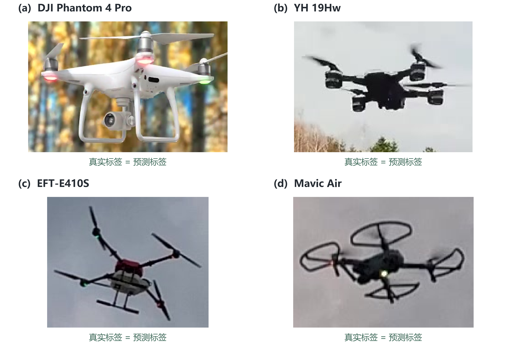

# 基于多源无人机图像的机型分类方法比较与视觉证据分析

## 摘要

无人机机型分类属于具有实际应用价值的细粒度视觉识别任务。不同机型可能共享相似的旋翼布局和机身结构，目标在图像中所占区域、观察视角、运动状态与背景条件也会改变可利用的视觉线索。本文面向已获得目标框的无人机图像分类场景，构建了一个覆盖12种机型、包含20,010张真实目标裁剪的统一实验数据集，并按照场景与相似性约束划分训练集和测试集，分别包含14,106张和5,904张图像。研究对比HOG、HSV、LBP手工表示，冻结SigLIP2视觉表示，以及Qwen3-VL-2B的零样本和QLoRA监督适配路径；传统路径使用逻辑回归、K近邻、RBF-SVM和随机森林进行横向比较。实验结果显示，手工表示调优KNN取得73.07%的测试准确率和61.08%的Macro-F1，是本实验中表现最好的传统方案；标准QLoRA将零样本准确率由1.59%提高至49.46%，说明监督标签格式和任务适配对闭集机型分类具有明显作用。类别加权适配的Macro-F1与标准适配接近，未表现出稳定的整体增益。进一步的表示替换、参数搜索、尺度分层和类别级混淆分析表明，模型表现由视觉表示、分类边界和样本可辨识线索共同决定。本文给出完整的数据采集、清洗、划分、建模、调参和问题记录，并将代码与复现材料公开保存。

**关键词：** 无人机机型分类；细粒度视觉识别；视觉表示；QLoRA；模型比较；数据采集

项目代码仓库：https://github.com/fangdawei33/uav-type-classification-course-project

## 1 引言

无人机视觉识别通常包含两个层次：首先判断图像中是否存在无人机，其次在多个外形相近的机型之间完成细粒度区分。本文聚焦第二个层次，并将研究条件明确为“目标框已经获得”。在这一条件下，任务仍然具有较高难度：机型差异往往集中在相机吊舱、机臂连接、旋翼保护结构和机身比例等局部区域；当目标较小或姿态变化明显时，能够支持类别判断的证据会快速减少。因而，分类结果既反映模型的判别能力，也反映图像中可供识别的视觉信息量。

近年来，预训练视觉编码器和视觉语言模型为小样本视觉任务提供了新的建模路径。预训练表示能够把图像转换为通用向量，再由轻量分类器完成任务适配；视觉语言模型则可以通过指令和监督答案直接学习标签输出。然而，模型参数规模并不能自动转化为细粒度机型识别能力。对于类别相似、目标尺度变化明显的图像，必须在相同数据划分和相同测试清单上比较不同表示与适配方式，才能判断方法是否真正适合任务。

本文围绕以下问题展开实验：

1. 手工视觉表示、冻结预训练视觉表示和视觉语言模型适配在无人机机型分类上的表现有何差异？
2. 监督适配和类别加权分别对视觉语言模型的闭集标签预测产生多大影响？
3. 目标尺度、类别相似性和视觉证据差异如何影响模型的分类结果？

本文的工作重点是建立一套可复现的课程综合实验流程：从公开数据采集和网页爬虫开始，完成图像筛选、目标裁剪、标签统一、训练测试划分、四类传统模型比较、预训练表示实验、QLoRA适配、网格搜索和结果分析。HOG、SigLIP2、LoRA和QLoRA均为已有方法，本文不将其包装成新的算法，而是通过统一实验回答它们在本任务中的实际表现。


图1 研究问题与比较框架。研究对象为目标框已知条件下的12类无人机机型分类；三条模型路径独立比较，共享输入清单和统一测试评价。

## 2 相关工作与理论基础

### 2.1 无人机机型分类与细粒度视觉识别

无人机分类数据通常同时包含目标类别、图像来源和目标框等信息。对于机型识别，类别之间的外观差异小于“无人机与背景”的目标检测差异，因此旋翼数量、机臂形态、机身轮廓、起落架和摄像头结构等局部部件具有更高的判别价值。图像压缩、运动模糊、视角变化以及目标尺寸变化会改变这些线索的可见程度，这也是本文进行原生尺度统计和类别级分析的原因。

本实验使用两个公开图像来源构建统一机型标签空间。其中Drone-type-Set提供7种机型类别，VisioDECT公开版本提供5种机型类别。本文沿用来源提供的机型标签，在统一清单中重新编码为0至11；“12种机型”表示12个类别，而不是12位数据作者。网页爬虫采集的公开图片和文本只用于展示真实采集流程、溯源和弱标签处理，不直接替代主监督数据。

### 2.2 传统视觉特征与分类器

HOG通过局部梯度方向统计描述轮廓和边缘结构，HSV统计与直方图描述色彩和亮度分布，LBP描述局部纹理模式。三类特征拼接后，可以从形状、颜色和纹理三个角度提供人工设计的视觉表示。逻辑回归代表线性判别模型，KNN依据特征空间中的邻域进行投票，RBF-SVM通过核函数构造非线性决策边界，随机森林通过多棵随机化决策树进行集成。四种模型分别代表线性、邻域、核方法和树集成，满足课程对多模型比较的要求。

### 2.3 预训练表示、视觉语言模型与QLoRA

SigLIP2将图像映射为预训练视觉向量。本文冻结视觉编码器，只训练后接的传统分类器，因此可以观察“预训练表示+浅层决策边界”这一迁移路径。Qwen3-VL-2B则接收图像和指令并生成标签字符串；为使生成任务成为闭集分类，提示词将12个候选机型映射为LABEL_00至LABEL_11。QLoRA在量化基座上注入低秩适配器，只更新少量参数，适合在有限GPU预算下进行监督适配。

### 2.4 评价指标与交叉验证

Accuracy反映总体预测正确比例，Macro-F1对测试中实际出现的每个类别等权平均，能够避免大类别完全主导结果；加权F1按类别样本数加权。传统模型的超参数只使用训练集内部的两折分组交叉验证选择，测试集只在最终模型冻结后使用。这样的流程把模型选择和最终评价分开，避免用测试结果反复调整参数。

## 3 数据与方法

### 3.1 数据采集与数据集构建

数据构建包括公开数据登记、网页信息采集、图像清洗、目标框核验、标签统一和哈希溯源六个步骤。下载脚本首先登记来源、文件名、类别和标注关系，再检查图片与标注是否一一配对；网页爬虫只访问公开可见页面，按照robots规则和允许来源配置选择正文中的图片、图注与链接字段，并设置请求间隔。遇到无法确认权限、访问限制或内容选择器失效时，程序记录日志并停止该来源。

公开图像经过RGB转换、目标框范围检查、空框过滤、重复哈希检查和原生尺寸记录后生成分类裁剪。数据清洗的目标是保证样本能够被正确读取、标签和目标框能够追溯、训练和测试之间不存在相同约束组；对于低分辨率、暗图和低对比度图像，保留其真实状态并记录质量字段。这样可以在后续分析中讨论任务的视觉难度，而不会把困难样本从测试结果中删除。

表1列出各来源的角色，表2给出12种机型的样本分布。主监督数据共20,010张，网页爬虫记录和第三方合成数据作为独立的辅助材料保存，不与主测试指标混合。

表1 原始数据获取与使用角色

| 来源 | 原图数量 | 本实验角色 |
| --- | --- | --- |
| Drone-type-Set 公开数据目录 | 2973 | 审核后七类 2,720 张进入主数据 |
| VisioDECT 公开数据版本 | 20924 | 审核后五类 17,290 张进入主数据 |
| 自编公开网页爬虫 | 179 | 弱标签材料与身份参考，未参与主评估 |
| 第三方四类合成数据 | 8001 | 独立辅助实验，未合并主结果 |
| 原始总表 | 32077 | 包含不同角色，不能等同训练集规模 |

表2 类别与训练测试分布

| 标签 | 机型类别 | 总数 | 训练集 | 测试集 | 约束组 |
| --- | --- | --- | --- | --- | --- |
| 0 | Bebop | 447 | 447 | 0 | 1 |
| 1 | DJI phantom 3 | 67 | 67 | 0 | 1 |
| 2 | DJI phantom 4 pro | 572 | 370 | 202 | 4 |
| 3 | Emax | 329 | 207 | 122 | 3 |
| 4 | Intel Aero RTF | 256 | 256 | 0 | 1 |
| 5 | Mambo | 578 | 578 | 0 | 1 |
| 6 | YH 19Hw | 471 | 396 | 75 | 2 |
| 7 | Anafi-Extended | 3371 | 2382 | 989 | 3 |
| 8 | DJIFPV | 3439 | 2327 | 1112 | 3 |
| 9 | EFT-E410S | 3552 | 2400 | 1152 | 3 |
| 10 | Mavic_Air | 3519 | 2356 | 1163 | 3 |
| 11 | Mavic_Enterprise | 3409 | 2320 | 1089 | 3 |
| 合计 | 12 种机型类别 | 20010 | 14106 | 5904 | 28 |


图3 主实验数据的类别、集合和目标尺度概览。各类别样本数、训练测试支持和原生短边分布共同描述实验输入。

### 3.2 数据划分与实验协议

数据按7∶3的目标比例划分训练集和测试集，随机种子固定为42。为减少同一场景、连续帧或高度相似图像同时出现在训练和测试中的影响，划分以约束组为基本单位；同一组不会被拆到两个集合。最终训练集14,106张，测试集5,904张，实际比例为70.495%和29.505%。测试集只在所有模型和参数冻结后使用。

传统模型在训练集内部执行两折分组交叉验证。由于部分类别在开发集只有一个可用约束组，内部验证只对具有可分组验证条件的6类计分，但12类样本仍然参与训练。测试集实际出现8类，因此正文同时报告支持集合和指标定义，不把没有测试样本的类别写成“性能为零”。表3和表4分别给出模型参数与验证划分。

表3 传统模型基础参数

| 模型 | 关键参数 | 预处理与用途 |
| --- | --- | --- |
| 逻辑回归 | max_iter=3000；class_weight=balanced；seed=42 | 中位数填补＋去常量＋标准化 |
| KNN | n_neighbors=5；weights=uniform；p=2 | 中位数填补＋去常量＋标准化 |
| RBF-SVM | C=1；gamma=scale；class_weight=balanced；ovr | 中位数填补＋去常量＋标准化 |
| 随机森林 | 300 棵树；class_weight=balanced；n_jobs=1；seed=42 | 中位数填补＋去常量；不标准化 |

表4 训练集内部的两折分组验证

| 验证轮次 | 训练折样本 | 验证折样本 | 类别覆盖规则 |
| --- | --- | --- | --- |
| 1 | 7826 | 6280 | 6 类计分／12 类训练 |
| 2 | 8231 | 5875 | 6 类计分／12 类训练 |

<!-- equation:split:1 -->

$$
\mathcal D_{tr}\cap\mathcal D_{te}=\varnothing,\quad G_{tr}\cap G_{te}=\varnothing\tag{1}
$$

训练集和测试集的样本集合与约束组集合分别记为D_tr、D_te和G_tr、G_te，则划分满足：

<!-- equation:split:2 -->

$$
\mathcal D_{tr}\cap\mathcal D_{te}=\varnothing,\quad G_{tr}\cap G_{te}=\varnothing\tag{2}
$$

其中D_tr与D_te不相交，G_tr与G_te也不相交。该协议用于保证图像级比较的可追溯性，并把连续帧和相似场景带来的评估偏差控制在可解释范围内。

### 3.3 特征工程与传统模型

手工路径将图像统一缩放到128×128，在保留原生宽高比统计的同时提取HOG、HSV、LBP、灰度均值、灰度标准差和宽高比，共1,831维。缺失数值只在当前训练折内使用中位数填补，常量维度由VarianceThreshold排除；逻辑回归、KNN和RBF-SVM使用训练折估计的StandardScaler，随机森林直接使用未标准化的数值特征。标准化公式为：

<!-- equation:scale:3 -->

$$
z_j=\frac{x_j-\mu_{j,tr}}{\sigma_{j,tr}}\tag{3}
$$

SigLIP2路径使用google/siglip2-base-patch16-224的冻结图像编码器，输出768维向量并执行L2归一化。手工表示和SigLIP2表示分别输入逻辑回归、KNN、RBF-SVM和随机森林，因此模型比较只改变表示或分类器，不把多个分类器的结果融合。

<!-- equation:siglip:4 -->

$$
x_S=\frac{f_\theta(I)}{\|f_\theta(I)\|_2}\in\mathbb R^{768},\quad\theta\text{ frozen}\tag{4}
$$

### 3.4 Qwen视觉语言模型与监督适配

Qwen路径将目标裁剪和固定标签说明组成图像指令，要求模型输出LABEL_00至LABEL_11中的一个字符串。视觉主干保持冻结，基座采用4-bit NF4存储，并在语言侧投影层注入LoRA。对于适用线性层，QLoRA更新形式为：

<!-- equation:lora:5 -->

$$
W'=W_{NF4}+\frac{\alpha}{r}BA,\quad r=8,\quad\alpha=16\tag{5}
$$

训练只对答案位置计算交叉熵，提示词和图像输入位置屏蔽。标准适配和类别加权适配均训练1轮、学习率1×10⁻⁵、微批大小1、梯度累积8、LoRA dropout 0.05、weight decay 0.01、warmup ratio 0.03，共1,764个优化步。类别加权采用训练集计数的平方根逆频率，作为已执行的消融组件；零样本、标准适配和加权适配使用相同测试集。

### 3.5 评价指标与调参方法

对测试中真实出现的类别集合S，Macro-F1定义为：

<!-- equation:macro:6 -->

$$
MacroF1(S)=\frac1{|S|}\sum_{c\in S}\frac{2P_cR_c}{P_c+R_c}\tag{6}
$$

其中P_c和R_c分别为类别c的精确率和召回率。网格搜索只在开发集内部进行，KNN搜索邻居数k∈{3,5,9,15}和投票权重{uniform,distance}，以两折平均Macro-F1选取参数；最终模型再用全部训练集拟合，并在冻结测试集上报告结果。

## 4 实验结果

### 4.1 实验环境与总体结果

实验在Google Colab的NVIDIA A100环境完成，使用Python 3.13.15、PyTorch 2.11.0、Transformers 4.57.1和scikit-learn 1.6.1，随机种子为42。代码、配置、日志、数据清单和结果回执均保存在项目仓库中。表5给出13组设置在同一冻结测试集上的结果。

### 4.2 多模型比较

表5 十三组模型评价指标

| 表示与模型 | Accuracy | 平衡准确率 | Test-F1 | 加权 F1 | CV-F1 |
| --- | --- | --- | --- | --- | --- |
| 手工＋调优 KNN | 0.7307 | 0.5819 | 0.6108 | 0.7372 | 0.6255 |
| 手工＋KNN | 0.7276 | 0.5705 | 0.6029 | 0.7346 | 0.6152 |
| SigLIP2＋KNN | 0.5993 | 0.5928 | 0.5749 | 0.5832 | 0.8017 |
| SigLIP2＋调优 KNN | 0.5960 | 0.5885 | 0.5739 | 0.5784 | 0.8147 |
| 手工＋RBF-SVM | 0.6618 | 0.5712 | 0.5478 | 0.6662 | 0.6079 |
| SigLIP2＋逻辑回归 | 0.5908 | 0.6187 | 0.5452 | 0.5734 | 0.7928 |
| SigLIP2＋RBF-SVM | 0.5628 | 0.5739 | 0.5224 | 0.5420 | 0.7691 |
| 手工＋逻辑回归 | 0.6145 | 0.5263 | 0.5036 | 0.6248 | 0.5574 |
| SigLIP2＋随机森林 | 0.5108 | 0.4635 | 0.4420 | 0.4708 | 0.7930 |
| Qwen 加权 LoRA | 0.4804 | 0.3609 | 0.3670 | 0.4721 | — |
| Qwen 标准 LoRA | 0.4946 | 0.3645 | 0.3668 | 0.4841 | — |
| 手工＋随机森林 | 0.4314 | 0.3523 | 0.3147 | 0.3793 | 0.4871 |
| Qwen 零样本 | 0.0159 | 0.0582 | 0.0794 | 0.0217 | — |


图4 13组模型设置在同一测试集上的Accuracy和Macro-F1。结果用于比较表示路径、分类器和监督适配，展示顺序不参与模型选择。

手工特征调优KNN取得最高测试Accuracy 0.7307和Macro-F1 0.6108；未经调优的手工KNN也达到0.7276和0.6029。SigLIP2与四类分类器组合的表现处于中间区间，说明预训练视觉表示能够提供可用信息，但其优势依赖后续分类器与当前数据分布。Qwen标准QLoRA的Accuracy为0.4946、Macro-F1为0.3668，明显高于零样本的0.0159和0.0794，说明监督适配是闭集标签预测中的关键步骤。

四类传统模型覆盖线性、邻域、核和树集成原理，结果说明集成学习并不天然优于其他模型；在本任务中，手工特征与距离型决策边界组合得到了更好的测试表现。该结论只针对本实验设置，不把模型名称或参数规模直接等同于识别能力。

### 4.3 监督适配消融

表6和图5比较零样本、标准适配及类别加权适配。标准监督适配使Accuracy提升47.866个百分点，Macro-F1提升28.742个百分点；类别加权相对标准适配的Accuracy下降1.423个百分点，Macro-F1仅增加0.022个百分点。因而，监督适配带来了明确的任务适应效果，而当前类别加权规则没有带来整体性能提升。类别加权改变的是损失中不同标签的贡献，不能增加新的视觉信息，也不能替代更多具有判别性的机型样本。

表6 监督适配与类别加权组件消融 分数单位为百分数

| 设置 | 监督适配 | 全局类别权重 | Accuracy | Macro-F1 |
| --- | --- | --- | --- | --- |
| − 监督适配 | 关闭 | 关闭 | 1.59 | 7.94 |
| 标准设置 | 开启 | 关闭 | 49.46 | 36.68 |
| + 类别加权 | 开启 | 开启 | 48.04 | 36.70 |


图5 视觉语言模型的监督适配与类别加权消融。左侧比较三个已执行配置，右侧显示类别加权相对标准适配的逐类F1变化。

### 4.4 表示替换与超参数调优

表7和图6固定分类器，比较手工表示与SigLIP2表示。随机森林在SigLIP2表示上比手工表示提高12.72个百分点，逻辑回归提高4.16个百分点；KNN和RBF-SVM则略有下降。这说明表示和分类器之间存在匹配关系，不能用表示维度或预训练规模单独预测最终结果。

表7 相同分类器下的表示替换 对应测试Macro-F1

| 分类器 | 手工 / % | SigLIP2 / % | 变化 / 百分点 |
| --- | --- | --- | --- |
| 逻辑回归 | 50.36 | 54.52 | +4.16 |
| KNN | 60.29 | 57.49 | -2.80 |
| RBF-SVM | 54.78 | 52.24 | -2.54 |
| 随机森林 | 31.47 | 44.20 | +12.72 |


图6 固定分类器条件下的手工表示与冻结SigLIP2表示比较。每个柱状组沿用同一数据划分和评价指标。

网格搜索选择了k=3、distance加权。手工表示的两折CV-F1由0.6152提高至0.6255，测试Macro-F1由0.6029提高至0.6108；SigLIP2的CV-F1由0.8017提高至0.8147，但测试Macro-F1由0.5749变为0.5739。该结果说明内部验证有助于规范参数选择，但验证分布和测试分布仍可能存在差异。

表8 KNN 调优前后指标

| 表示与阶段 | 邻居数／权重 | CV-F1 均值±标准差 | 测试准确率 | 测试 Macro-F1 |
| --- | --- | --- | --- | --- |
| 手工调优前 | 5／uniform | 0.6152 ± 0.0658 | 0.7276 | 0.6029 |
| 手工调优后 | 3／distance | 0.6255 ± 0.0455 | 0.7307 | 0.6108 |
| SigLIP2调优前 | 5／uniform | 0.8017 ± 0.0485 | 0.5993 | 0.5749 |
| SigLIP2调优后 | 3／distance | 0.8147 ± 0.0593 | 0.5960 | 0.5739 |

表9 调优后的指标变化 单位为百分点

| 表示 | CV-F1 变化 | 测试准确率变化 | 测试 Macro-F1 变化 |
| --- | --- | --- | --- |
| 手工 | +1.029 | +0.305 | +0.791 |
| SigLIP2 | +1.302 | -0.322 | -0.099 |


图7 KNN网格搜索结果。色标为训练集内部两折平均Macro-F1，测试指标未参与参数搜索。


图8 标准QLoRA与类别加权QLoRA的训练损失日志。曲线用于记录优化过程，不作为独立验证性能。

## 5 讨论

### 5.1 模型表现与类别混淆

总体Accuracy受样本较多的类别影响，Macro-F1则更关注每个有测试样本类别的均衡表现。图9给出手工调优KNN与标准QLoRA的逐行归一化混淆矩阵，图10给出测试支持类别的逐类F1。手工KNN在当前测试清单上形成较好的整体平衡；Qwen标准适配已经能够学习部分闭集标签边界，但在外观相近的类别之间仍出现较明显混淆。


图9 手工调优KNN与标准QLoRA的逐行归一化混淆矩阵。行标签同时标出真实样本数，C00至C11对应统一标签编码。


图10 测试集实际支持类别的逐类F1。没有测试样本的类别不参与该图的逐类比较。

结果表明，不同模型的差异不仅来自学习器本身，也来自表示对形状、颜色、纹理和语义信息的组织方式。随机森林在高维描述子上的表现低于KNN，并不能说明随机森林方法本身无效，而说明当前特征空间和参数配置更适合距离型分类边界。

### 5.2 视觉证据与目标尺度

目标尺度是该任务难度的重要组成部分。主清单原生裁剪短边中位数为51像素，测试集中短边小于24像素的样本通常只能保留轮廓级线索，难以稳定观察相机、支架和机臂连接等细节。图11中的样例仅展示标准QLoRA已经正确识别的真实测试样本，用于说明不同机型的可见外观；总体性能仍以全量5,904张测试图像的指标为准。



图11 标准QLoRA正确分类样例。样本来自固定测试集，保持原始裁剪内容和比例，仅用于展示可辨识的正确案例，不代表整体准确率。

对测试预测按原生短边分层后，标准QLoRA在短边小于24像素的332张图像上准确率为8.43%，在48至63像素的1,385张上为75.31%，在至少96像素的598张上为33.61%。分层结果不是单调曲线，因为不同尺度区间的类别和来源组成并不相同；它反映的是视觉证据、类别组成和模型行为的共同结果。图12进一步给出三种代表设置的分层表现。


图12 固定测试集上的原生目标尺度分层。各区间保留真实测试样本，结果用于描述不同视觉证据条件下的模型行为。

### 5.3 特征解释与误差来源

随机森林的重要性排序中，LBP、饱和度和色调统计特征排名较靠前，说明当前树模型使用了纹理和颜色分布信息。由于这些特征也可能受到背景、光照和成像条件影响，因此重要性只能作为模型行为线索，不能解释为机型差异的因果因素。图13给出前12项不纯度重要性。


图13 手工特征随机森林的前12项不纯度重要性。重要性用于解释该模型的决策线索，不代表因果关系。

误差主要集中在三类情形：一是目标尺度较小，机型部件没有形成稳定像素证据；二是不同机型具有相似外形，模型需要依靠局部结构而不是整体轮廓区分；三是视角、遮挡、运动模糊和背景改变了外观分布。连续帧或相似转载还可能使图片级随机划分高估模型能力，因此本文使用来源和相似性约束组划分，并把同组样本限制在同一数据集合中。该协议服务于本次图像级比较；若要研究跨飞行任务泛化，还应在未来采集具有飞行任务标识的独立数据进行验证。

### 5.4 过拟合、欠拟合与实验边界

传统模型训练准确率普遍高于测试准确率，说明模型能够较好地拟合开发集中的视觉模式，而测试集中的类别组成、来源和视觉条件带来了更高的判别要求。对于KNN，训练准确率接近1还与样本自身参与邻域投票有关，不能单独作为数据泄露证据。更可靠的判断应结合组间交叉验证、冻结测试集和逐类结果。

表10 传统模型训练与测试准确率

| 表示与模型 | 训练准确率 | 测试准确率 |
| --- | --- | --- |
| 手工＋逻辑回归 | 1.0000 | 0.6145 |
| 手工＋KNN | 0.9687 | 0.7276 |
| 手工＋RBF-SVM | 0.9988 | 0.6618 |
| 手工＋随机森林 | 1.0000 | 0.4314 |
| 手工＋调优 KNN | 1.0000 | 0.7307 |
| SigLIP2＋逻辑回归 | 1.0000 | 0.5908 |
| SigLIP2＋KNN | 0.9974 | 0.5993 |
| SigLIP2＋RBF-SVM | 0.9995 | 0.5628 |
| SigLIP2＋随机森林 | 1.0000 | 0.5108 |
| SigLIP2＋调优 KNN | 1.0000 | 0.5960 |

Qwen路径只执行一轮训练且没有独立验证曲线，因此不能仅依据训练损失下降判断泛化效果。当前结果说明监督适配能够显著改变输出分布，但也提示视觉主干是否需要适配、提示词格式是否足够稳定、训练预算是否合理，仍需要额外实验验证。本文把这些内容作为后续研究方向，不把尚未运行的实验写成已取得的结果。

### 5.5 方法价值与后续工作

本实验的价值在于建立了从数据采集到模型评价的完整可追溯链条，并把传统机器学习、预训练视觉表示和视觉语言模型放在同一测试协议下比较。结果没有预设“大模型一定更强”，而是显示：在当前图像证据和训练设置下，手工表示结合KNN具有较强竞争力，Qwen监督适配相对零样本有明显改进，类别加权则需要更充分的类别覆盖和多次重复实验才能判断是否有效。

后续工作包括：增加每类具有清晰来源和任务标识的图像；在训练集内部建立固定验证集和多随机种子重复；对HOG、HSV和LBP进行真正的特征块消融；比较视觉主干冻结与部分解冻；针对小目标设计尺度感知的训练和评价；以及使用独立飞行任务数据检验跨场景泛化。上述方向都应在新的数据版本和新的冻结测试集上登记，避免把测试集反复用于方法选择。

## 6 结论

本文完成了一个面向真实无人机图像的机器学习综合实验，覆盖公开数据采集、网页爬虫、图像清洗、目标裁剪、标签统一、数据划分、多模型训练、网格搜索、视觉语言模型适配、消融实验和误差分析。实验比较了四类传统分类器、两种视觉表示和三种Qwen设置，并在统一测试清单上报告结果。

手工视觉表示调优KNN取得73.07%的测试准确率和61.08%的Macro-F1；Qwen标准QLoRA相对零样本取得明显提升，但当前表现仍低于最佳传统基线；类别加权没有形成整体增益。尺度分层和类别混淆分析进一步说明，机型识别的关键在于图像中是否保留了足够的结构证据，以及表示和决策边界是否与任务匹配。完整的过程记录、问题解决方法、四道课程思考题和运行方式保留在附录中，代码与复现材料通过项目仓库公开。

## 附录A 数据采集与预处理过程

### A.1 数据获取与爬虫设计

采集分为作者公开数据导入和自编网页爬虫两条路径。Drone-type-Set 公开目录实际取得 2,973 张原图及同名标注；VisioDECT 公开数据版本编目 20,924 张图像。程序只登记实际可取得的文件，不将论文中更大的名义数量作为已下载数量。第三方四类合成原图 8,001 张作为独立辅助材料。网页爬虫最终取得 179 张原图；其中清洗后的 135 张弱标签目标裁剪与 4 张身份参考单独交付，没有进入本次主监督训练和测试。早期日志中的 171 是采集过程快照，最终数量以交付回执为准。


文章爬虫读取配置中的来源 URL、允许主机、正文选择器、标题关键词和候选类别。先检查 robots，再按请求间隔访问正文；保存 HTML 快照后提取 img 的 src、srcset、alt 和上下文图注，保留页面实际出现的链接。下载阶段只处理明确选中的媒体，记录原始字节哈希、时间和许可状态。Commons 采集器同时登记文件页、作者与许可信息。访问失败、标题不符、无效图片和未知许可分别记录，不依靠破解反爬获取数据。

原始 CSV 包含 sample_id、source_url、download_url、collected_at、sha256、candidate_label、title、description、caption、width、height、group_id、license_review 等字段。其中 ID 与哈希用于溯源，尺寸用于质量诊断，标签与分组需审核，标题和描述属于混杂文本，不能直接当数值送入模型。


来源：文章样例来自 https://www.halfchrome.com/tello-vs-mambo/；原始 CSV 为 data/metadata/drone_type_article_raw.csv 和 drone_type_external_raw.csv。此处展示采集时记录，后续审核状态保存在独立决策表，不伪装为原始字段已自动确认。

代码1 robots 检查后的请求入口与文章正文解析节选

```python
# src/uav_project/http_client.py 的 Web.get
def get(self, url, max_bytes=25_000_000):
    self.allowed(url)
    return self.raw(url, max_bytes)
```

```python
containers = soup.select(source['content_selector'])
if not containers:
    raise ValueError('Configured article-content selector found no content; preserve HTML: ' + snapshot)
title_node = soup.select_one(source.get('title_selector', 'h1'))
title = title_node.get_text(' ', strip=True) if title_node else ''
```

allowed 方法核验 HTTPS、来源白名单与 robots；raw 方法执行延时、重定向复核、流式大小上限和最多三次请求尝试。文章配置请求间隔为 2 秒，若站点给出更长 crawl-delay 则采用更长间隔。403 或无法确认 robots 时停止对应来源；原始下载重试和网页解析代码均保留在仓库。

表11 自采集原始记录示例

| 字段 | 文章样例 | Commons 样例 |
| --- | --- | --- |
| sample_id | dta_4feae19ca5e40e4d044f | dte_e979f5fddecf1e4d92c4 |
| 候选类别／原图尺寸 | Mambo／1024×580 | Bebop／816×538 |
| 网页标题 | Ryze Tello vs Parrot Mambo: Which is the Best Micro Drone? | File: Bebop Drone authorized flight over Paris Air Show.jpg |
| 图像文本线索 | Top angle view of Parrot Mambo | Parrot drone over Le Bourget Air Show |
| 原始审核与许可状态 | 候选待审／许可未核验 | 候选待审／文件页记载 CC BY-SA 4.0 |

### A.2 缺失 异常 文本与裁剪处理

缺失值按字段职责处理。缺失目标标签、缺失目标框或解码失败不能自动生成监督样本；保留为待审核或排除记录。group_id 不完整时不将未知图片随机分配到不同集合。标题、描述或许可字段为空时保持来源不确定性，禁止把空许可视为允许再分发。主实验清洗表的 width、height、gray_mean、gray_std、laplacian_variance_128 在训练集中的缺失数均为 0。target_short_side_pixels 属于早期来源的可选字段，并非所有来源填写；统一从实际裁剪宽高重新计算短边。

表12 训练集质量字段缺失统计

| 数值字段 | 样本数 | 缺失数 |
| --- | --- | --- |
| width | 14106 | 0 |
| height | 14106 | 0 |
| gray_mean | 14106 | 0 |
| gray_std | 14106 | 0 |
| laplacian_variance_128 | 14106 | 0 |

清洗先核验原图字节哈希，将目标框的逗号分隔文本解析为四个有限浮点数，检查坐标方向、边界和面积，再按左上取 floor、右下取 ceil 生成 RGB 原生尺寸裁剪；保存后检查尺寸与像素一致性。对已存在的早期裁剪同时核对哈希和 RGB 像素，防止读取到不同版本。EXIF 方向不为 1 时停止该记录并要求核对坐标，而非盲目旋转后沿用旧框。

原七类排除 253 项，记录的原因包括烧录检测框与置信度、标题卡、字幕、画中画、错框、转场叠影及机身出画。扩展候选共 20,018 张，另排除 8 张无法辨认目标的裁剪，形成 20,010 张主清单。两次排除处于不同阶段，不应重复计数。文件夹仍可能保留历史排除文件，训练必须按清单读取。

文本处理采用 BeautifulSoup 提取正文与去除 HTML 标签，统一空白；类名通过固定映射转换为整数 y，框坐标解析为数值。标题、文件名、来源 ID 与网页描述不进入 X，防止模型从元数据猜标签。没有匹配的飞行日志，不编造飞行速度或传感器数值填充表格。

表13 原始图像与清洗裁剪对比

| 类别 | 原始尺寸 | 目标框 xyxy | 清洗尺寸 | 处理结果 |
| --- | --- | --- | --- | --- |
| Bebop | 1280×720 | 269,212,1108,672 | 839×460 | RGB 裁剪，像素核验 |
| Bebop | 1280×720 | 3,12,1280,519 | 1277×507 | RGB 裁剪，像素核验 |
| DJI phantom 4 pro | 416×416 | 177,222,192,241 | 15×19 | 短边小于 24，保留质量标记 |

代码2 目标框文本解析与裁剪核心代码

```python
values = tuple(float(v) for v in item['target_box_xyxy'].split(','))
if len(values) != 4 or not all(math.isfinite(v) for v in values):
    raise ValueError('Invalid box: ' + item['sample_id'])
x1, y1, x2, y2 = values
if not (0 <= x1 < x2 <= size[0] and 0 <= y1 < y2 <= size[1]):
    raise ValueError('Out-of-bounds box: ' + item['sample_id'])
rect = (math.floor(x1), math.floor(y1), math.ceil(x2), math.ceil(y2))
rgb = source.convert('RGB')
crop = rgb.crop(rect)
```

对短边小于 24 像素的样本，当前代码添加 short_side_below_24 标记，没有自动删除。低对比度和大面积暗区也仅触发质量提示。质量标记不代表已完成专家逐图审核；本实验未执行全量可辨认性复核或按尺度筛选后重新训练。

### A.3 特征工程与相关性记录

手工路径将裁剪转换到 128×128 计算特征，同时保留原生宽高比。HSV 三通道各含均值、标准差和 16 桶直方图，共 54 维；HOG 采用 9 个方向、16×16 像素单元、2×2 单元块，共 1,764 维；LBP 采用 8 邻点、半径 1、uniform 模式，共 10 维；灰度均值、灰度标准差和宽高比共 3 维。合计 1,831 维。

SigLIP2[2,6] 使用 google/siglip2-base-patch16-224 的冻结图像编码器，输出 768 维向量并进行 L2 归一化，模型 revision、处理器和推理精度在特征回执中固定。原生低分辨率图像即使被放大，也无法恢复真实机身细节。

标签采用固定的 0 至 11 整数编码，标签数值不表示大小或距离。输入不包含类别型表格特征，因此没有必要额外对机型标签做独热编码作为 X；监督目标 y 与输入 X 分开保存。文件名、URL、哈希、来源组与人工审核字段仅用于数据管理。训练集全量 X 的形状分别为 14,106×1,831 和 14,106×768，经过折内常量特征筛选后维数以相应模型的支持掩码为准。

代码3 折内填补 方差筛选与标准化流水线

```python
def pipe(model, scale=True):
    steps = [("impute", SimpleImputer(strategy="median")),
             ("variance", VarianceThreshold())]
    if scale:
        steps.append(("scale", StandardScaler()))
    return Pipeline(steps + [("model", model)])
```

该 Pipeline 在交叉验证时由每个训练折独立拟合；随机森林设置 scale=False，其他三类模型执行 StandardScaler。VarianceThreshold 使用默认阈值 0，只排除训练折内常量维度，不声称已通过相关性阈值删除全部冗余特征。

报告补充对已保存训练清单中质量字段的 Pearson 相关性分析：宽度与高度相关较高，宽高也与统一尺度下的拉普拉斯方差相关，提示目标尺度、构图和清晰度统计并非完全独立。此项为结果解释，不参与本次模型选择，也不把质量字段之间的相关性等同于 1,831 维全部特征的相关性。

表14 训练集部分质量字段相关系数

| 字段组合 | Pearson r |
| --- | --- |
| 宽度与高度 | 0.9423 |
| 宽度与拉普拉斯方差 | 0.8502 |
| 高度与拉普拉斯方差 | 0.8505 |

## 附录B 数据划分 模型与评价关键代码

### B.1 训练 验证 测试与泄露控制

常见三类数据角色是：训练集拟合模型，验证集选择参数或检查点，测试集评价最终固定方案。本实验采用训练集内部交叉验证，因此不要求另存一份固定验证集。原代码把可用于训练和调参的 14,106 张称为 development，把保留到最后评价的 5,904 张称为 holdout。本报告统一称为训练集与测试集；为保持历史清单和哈希不变，CSV 与源码中的原英文取值保留，对应关系在附录说明。

按预先构造的场景与相似性约束组整体划分，以接近 30% 测试量为目标，最终训练／测试占比为 70.495%／29.505%，种子为 42。整组不可拆分，所以不是严格逐样本随机 7∶3。训练与测试的 group_id 集合无交集，但这些约束组用于降低相似图像跨集合带来的影响；本文将组间不重叠解释为评估协议的一部分，不将其等同于已完成跨飞行任务验证。


验证折只对标签 2、7、8、9、10、11 共 6 类计算 Macro-F1，其余 6 类因训练集内只有一个约束组，始终留在每轮训练折中；各训练折仍包含全部 12 个标签。因此这是带有始终训练样本的两折分组验证，不能说每张样本都轮流做过验证，也不能把验证分数称为完整十二类交叉验证成绩。传统模型选参结束后在全部 14,106 张训练样本上重新拟合。

Qwen 两个 LoRA 版本都在全部训练集上按预设参数训练一轮，没有另设固定验证集，没有验证损失选检查点或验证早停。测试集在模型、参数、提示词与协议冻结后评价，未用于这次选参。没有独立验证集是本次大模型实验的局限，不能在报告阶段补写成做过三集划分。未来如需早停或比较更多 LoRA 方案，应先在训练组内设定验证组，再用新的独立测试版本评价。


代码4 按组构造训练折与验证折节选

```python
for fold in protocol["folds"]:
    validation_groups = set(fold["validation_group_ids"])
    val_mask = development.group_id.isin(validation_groups).to_numpy()
    train_idx, val_idx = np.flatnonzero(~val_mask), np.flatnonzero(val_mask)
    if not len(train_idx) or not len(val_idx):
        raise ValueError(f"Empty group CV fold {fold['fold']}")
    train_groups = set(development.iloc[train_idx].group_id)
    val_groups = set(development.iloc[val_idx].group_id)
    if train_groups & val_groups or set(development.iloc[train_idx].label) != set(range(12)):
        raise ValueError(f"Group leak or missing training labels in fold {fold['fold']}")
```

泄露防护包括：相关样本整体分组，训练折内拟合预处理器，测试特征只在最终评价阶段生成；超参数依据训练内部验证分数；固定数据清单、代码哈希、模型与提示词；续跑时核验同一冻结版本和预测前缀。中断后恢复已冻结测试推理不等于重新调参。测试成绩已经公开后，再根据错误案例优化方法，应视为新实验并使用新独立测试数据。

### B.2 多模型实现

逻辑回归以线性类别得分和概率损失学习边界；KNN按特征距离选邻居并投票；RBF-SVM以核映射学习非线性间隔，C控制正则化而gamma控制局部影响；随机森林对随机化决策树进行集成，能表达非线性交互并提供不纯度重要性。四者分别代表线性、邻域、核和树集成原理，均由训练样本建立决策规则。

两种表示各训练四个基础分类器，分别构成八组传统基线；每种表示再对验证最优的模型族执行一次网格搜索，形成两组调优结果。Qwen 零样本、标准 LoRA 与加权 LoRA 共三组，合计十三组。模型使用相同主数据版本和测试样本，不将早期合成集的高准确率放到本表比较。


代码5 基础模型的交叉验证与最终训练节选

```python
scores = cross_val_score(estimator, X, y, cv=cv, scoring=scorer, n_jobs=jobs, error_score="raise")
estimator.fit(X, y)
joblib.dump(estimator, model_path, compress=3)
train_report = classification_report(y, estimator.predict(X), labels=list(range(12)),
    target_names=protocol["classes"], output_dict=True, zero_division=0)
```

Qwen 采用 4-bit NF4、float16，图像像素范围 50,176 至 150,528，输入最大长度 1,024，最多生成 8 个新 token；LoRA r=8、alpha=16、dropout=0.05，学习率 1×10⁻⁵，weight_decay=0.01，warmup_ratio=0.03。每设备 batch=1，梯度累积 8，启用梯度检查点；每个版本训练 1 epoch，回执记录各 1,764 个优化步。适配目标为语言侧 q_proj、k_proj、v_proj、o_proj、gate_proj、up_proj、down_proj，视觉模块不训练。两个版本只在预先声明的样本损失权重上不同，并非训练后依测试集选择加权方案。

### B.3 指标与网格搜索实现

Accuracy为全部测试样本预测正确的比例；平衡准确率为实际出现类别召回率的均值；Weighted-F1按真实样本数加权各类F1。Macro-F1对支持集合内的类别等权平均，因而更关注低频类别；所有指标必须与对应支持集合共同解释。

先在相同训练内分组折上按支持六类的平均 Macro-F1 选择模型族。两种表示实际选中 KNN，随后只搜索 n_neighbors∈{3,5,9,15}、weights∈{uniform,distance}，共 8 组参数，每种表示执行 16 次验证拟合，再以最佳参数全训练集 refit。两者均选中 n_neighbors=3、weights=distance。源码为其他分类器保留的参数网格不代表本次也全部执行过。

代码6 网格搜索实现节选

```python
grid = GridSearchCV(candidates[selected], grids[selected], cv=cv, scoring=scorer,
                    n_jobs=jobs, refit=True, error_score="raise", return_train_score=True)
grid.fit(X, y)
```

scorer 使用 f1_score 的 labels=[2,7,8,9,10,11]、average='macro' 和 zero_division=0。模型族选择和调参共用同一组验证折，没有嵌套交叉验证，最优验证分数可能偏乐观。预先按交叉验证选中的传统模型是 SigLIP2＋调优 KNN；最终测试中手工特征更好属于观察结果，不能倒过来声称它在测试前已被选为最优。主研究方法 Qwen 标准 LoRA 是预先声明的方法，不因测试低分改名替换。

最终测试有真实样本的类别为 2、3、6、7、8、9、10、11 共 8 类，正文 Macro-F1 明确对这八类计分，另保存全十二标签口径。预测成测试中没有真实样本的类别仍会造成真类漏判，未从准确率中删除。缺失的四类测试支持数为 0，不能用把它们的 F1 设零来证明这些类别的真实泛化能力。

代码7 测试指标的实际实现节选

```python
supported_macro = float(f1_score(truth, prediction, labels=present, average="macro", zero_division=0))
return {"samples": int(len(frame)), "labels_present": present,
    "class_names_present": [protocol["classes"][index] for index in present],
    "accuracy": float(accuracy_score(truth, prediction)),
    "balanced_accuracy_present_labels": float(balanced_accuracy_score(truth, prediction)),
    "macro_f1_supported_labels": supported_macro,
    "macro_f1_all_12_labels": float(f1_score(truth, prediction, labels=all_labels,
                                              average="macro", zero_division=0)),
    "weighted_f1": float(f1_score(truth, prediction, labels=all_labels,
                                   average="weighted", zero_division=0)),
    "invalid_prediction_rate": invalid,
    "classification_report": report,
    "confusion_matrix_all_12": confusion_matrix(truth, prediction, labels=all_labels).tolist(),
    "confusion_matrix_with_invalid": confusion_matrix(truth, prediction, labels=all_labels + [-1]).tolist()}
```

### B.4 预测与统计补充

表15 标准 LoRA 真实与预测标签样例

| 样例编号 | 真实类别 | 预测类别 | 判定 |
| --- | --- | --- | --- |
| P01 | DJI phantom 4 pro | DJI phantom 4 pro | 正确 |
| P02 | DJI phantom 4 pro | DJI phantom 3 | 错误 |
| P03 | Anafi-Extended | Anafi-Extended | 正确 |
| P04 | Anafi-Extended | DJIFPV | 错误 |
| P05 | DJIFPV | DJIFPV | 正确 |
| P06 | DJIFPV | Mavic_Enterprise | 错误 |
| P07 | EFT-E410S | EFT-E410S | 正确 |
| P08 | EFT-E410S | DJIFPV | 错误 |

表16 手工特征随机森林的前六项重要性

| 特征名 | 不纯度重要性 |
| --- | --- |
| lbp_0 | 0.015097 |
| lbp_9 | 0.014172 |
| saturation_mean | 0.014135 |
| hue_mean | 0.013685 |
| lbp_1 | 0.013544 |
| hue_bin_9 | 0.013046 |

表17 原生目标裁剪短边统计

| 短边条件 | 样本数 | 占 20,010 张比例 |
| --- | --- | --- |
| 小于 12 像素 | 57 | 0.28% |
| 小于 16 像素 | 272 | 1.36% |
| 小于 24 像素 | 1262 | 6.31% |
| 小于 32 像素 | 3448 | 17.23% |
| 小于 48 像素 | 8306 | 41.51% |
| 小于 64 像素 | 14232 | 71.12% |

## 附录C 实验问题与解决方法

公开目录数量与论文名义数量不一致。七类目录实际取得 2,973 对，而非预设每类 1,000 对；初版程序因此停止。之后将实际清单与数量差异登记，按可访问子集处理，没有虚构缺少图片或把部分目录写成完整论文数据。

小文件批量下载缓慢，gdown 出现 Cannot retrieve the public link 报错。后续由浏览器下载公开目录压缩包，使用 ZIP 导入脚本核对文件和标注；这解决取得公开原始文件的路径问题，独立网页爬虫仍按来源规则执行，不用手动下载冒充自编爬虫。

部分网页返回 403 或无法取得 robots。采集器停止对应来源，记录请求、错误与 HTML 快照，再处理允许访问的其他来源；未绕过访问控制。公开网页图片的许可和类别身份并不随下载成功自动确认，相关候选保持弱标签角色。

结果整理中出现清单字段名 partition 与真实 split 不一致的问题，导致字段访问异常。按真实表头修正读取逻辑，并固定后续数据格式；缺失目标框或候选字段不匹配时回到原记录核对，禁止补造目标框以使代码运行。

Colab 测试推理续跑时，进度 JSON 声明已完成 3,250 或 4,500 张，但本地 evaluation 目录缺少对应预测前缀 CSV，触发 FileNotFoundError。恢复步骤依据 Drive 中已保存的最新前缀与 SHA-256，将 CSV 放回期望目录后继续同一冻结版本；最终返回三组 Qwen 各 5,904 条预测。恢复进度不应仅信任 completed_samples 数值，必须同时核验文件存在、哈希、样本顺序与冻结版本。

零样本大量输出同一标签。报告保留该失败结果与微调对比，未用规则改写预测来提高分数。小尺寸目标和缺少四类独立测试样本仍未解决，明确写入限制。报告复核还纠正了基础 KNN 与调优 KNN 的 CV 分数混用，以及将 EFT 类精确率误写成召回率的问题；以原始 JSON 与逐图预测为准。

## 附录D 课程思考题作答

### D.1 真实爬虫数据有哪些噪声及不预处理的后果

噪声包括缺失文本、标题与图片不符、重复或相邻帧、损坏图、格式差异、错误框、目标出画、字幕、检测框烧录与来源标签错误。网页还可能含宣传图、渲染图或身份未确认的相似产品。跳过预处理会造成读取异常、错误监督、背景捷径、尺度主导及训练测试重复，既可能降低实际识别能力，也可能虚高离线分数。本实验用原图与裁剪哈希、框校验、审核台账和分组协议缓解这些问题，但仍保留小目标与来源认证不足的限制。

### D.2 为什么 KNN 需要标准化而树通常不需要

KNN 的距离会被数值范围较大的维度主导。手工特征同时包含概率直方图、梯度统计和宽高比，不统一尺度会使“距离近”偏离预期。标准化参数应仅从当前训练折估计，不能在全数据上预先拟合。树模型逐维按阈值和排序切分，严格单调缩放通常只改变阈值数值而不改变候选分割顺序，所以随机森林通常无需标准化；这并不免除缺失、错误标签和泄露处理。

### D.3 训练好而测试差属于什么现象及缓解方法

通常首先考虑过拟合，同时排查来源域偏移、标签问题、预处理不一致与评估口径差异。本实验传统模型训练接近满分而测试下降，不能只归因于模型复杂；相关帧与来源条件差异同样需要检查。可在训练组内验证、加强正则化、限制容量、对深度模型验证早停、增加经过身份核实的独立数据并预定质量规则。不能用测试结果反复筛图、选参后仍把同一测试集当完全未见数据。

### D.4 为什么网格搜索应配合交叉验证

单次验证容易受样本和来源分配影响，交叉验证让各参数在相同多轮分组划分上比较，能观察平均表现与波动。本实验每种表示搜索 8 组 KNN 参数，采用两折而非测试集调参。直接利用测试集选参数会把测试信息引入训练决策，导致偏乐观估计；即使未对测试反向传播，也属于方法选择层面的泄露。交叉验证不能消除错误分组或少量来源带来的偏差，使用同一验证折选模型族与网格参数也有选择偏差。

## 附录E 环境 运行方式与开源材料

本地 Windows 环境负责数据采集、裁剪、清单整理与报告生成。主模型实验在 Google Colab 的 NVIDIA A100-SXM4-40GB 上完成，随机种子设为 42；早期四类合成辅助实验使用 T4，两套实验单独登记，不混入主结果。主实验返回环境记录为 Python 3.13.15、PyTorch 2.11.0+cu130、CUDA 13.0、Transformers 4.57.1、PEFT 0.17.1、Accelerate 1.15.0、bitsandbytes 0.48.2、NumPy 2.1.3、pandas 2.2.3、scikit-learn 1.6.1、scikit-image 0.25.2、Pillow 11.3.0。采集和可视化代码使用 requests、BeautifulSoup、matplotlib 等，完整依赖由 requirements 文件及运行回执记录。

项目代码仓库：https://github.com/fangdawei33/uav-type-classification-course-project

scripts 保存分阶段入口，src/uav_project 保存实现，configs 保存来源与参数，data/delivery 保存数据来源索引，reports 保存正文、图表和证据。源码与历史清单仍使用 development／holdout，分别对应本文训练集／测试集；validation 为训练内部临时验证折，不单独增加到 20,010 张之外。修改报告术语不修改冻结清单与模型结果。

主要运行入口如下，先依 README、docs/UAV12_EXPERIMENT.md 与 docs/UAV12_COLAB.md 准备数据和依赖，再执行所需阶段。已有冻结结果时不要为更新报告重新训练。

```text
01_download_public.py            公开目录数据登记与下载
01_import_public_zip.py          公开压缩包导入
02_crawl_external.py             Commons 公开网页采集
02b_crawl_articles.py            配置文章及媒体采集
03_review_data.py                审核记录与完整性核对
03b_review_external.py           外部网页样本审核
04_clean_data.py                 基础清洗入口
04h_process_expanded_images.py   扩展原生目标裁剪
04i_finalize_expanded_data.py    固定清洗数据版本
05d_prepare_uav12_protocol.py   生成训练测试与分组验证协议
06d_extract_uav12_features.py   手工或 SigLIP2 特征
07d_train_uav12_baselines.py    传统模型与网格搜索
07q_train_qwen3vl.py            Qwen QLoRA 训练
09d_freeze_uav12.py             冻结协议与工件
10d_evaluate_uav12.py           冻结测试评价
11d_export_uav12_report.py      结果导出
12_prepare_gpu_handoff.py       Colab 运行材料准备
13_export_colab_transfer.py     Colab 代码与数据传输
14_import_colab_results.py      Colab 结果导入
19–27_draw/build_*.py            当前论文图表与正文材料
```

代码采用 MIT 许可证；第三方图片、模型与数据许可单独适用。公开仓库提供代码、配置、可发布索引、汇总图表与报告，不直接再分发第三方原图、压缩包、基座权重和大体积特征。仅克隆仓库而没有合法取得的数据与模型缓存，不能直接复现全部数值。报告生成脚本需已经解包的结果 JSON／CSV 和交付清单，使用 pandas、python-docx 与 matplotlib，不调用模型、不启动训练。research_figures保存统计图、机制示意、真实案例、消融CSV与绘图回执，确保图表和固定结果对应。

结果包 SHA-256：a3479ced386e1dea40528d7dd7e50a47577ccf58d17b1599272f93185dcf3eea。最终评估时间：2026-10-23T10:59:46.343021+00:00。模型与数据冻结哈希：b4796acdb94e70b41240598ed441f6feb360f496cbf9294e80be07a45880e6d5。训练阶段的环境、配置、日志、模型版本和预测校验记录已用于结果核验；仓库不分发模型权重和运行压缩包。

当前研究论文的正文源码为 reports/final_report_research_v2.md，图表入口为 scripts/19_draw_motivation_figure.py、scripts/20_draw_correct_examples.py 和 scripts/22–27_draw_*.py；这些脚本只读取已冻结的结果 JSON／CSV 和合法取得的本地样本，不加载模型或重新训练。公式在 Word 中以可编辑 Office Math 保存，Markdown 保留对应 LaTeX。

## 附录F 课程总结与要求对应

本实验建立了公开数据导入与网页采集、质量审核、目标裁剪、特征提取、分组验证、多模型训练、调优和冻结测试的可追溯流程。课程要求的四种传统模型均有实测结果，进一步比较了冻结视觉表示与视觉语言模型适配。主数据共 20,010 张真实目标裁剪，十三组模型结果与原始预测相对应，手工调优 KNN 在当前测试集获得最高表现，Qwen 微调改善零样本但未超越该基线。

实验所体现的方法认识是：模型规模、样本总量与数据质量不能互相替代；类别覆盖、来源独立性和评价口径应与性能分数同时报告。数据处理和断点恢复属于研究过程的一部分，只有保存清单、参数和失败记录，才能区分真实方法效果与流程问题。

当前需要加强的知识环节包括来源鉴别与标签核验、小目标可辨认性评估、类不平衡下的分组划分、视觉骨干适配与预算控制，以及选择偏差和不确定性分析。下一阶段应优先补齐每类独立来源与固定验证协议，再设计尺度分层、视觉侧适配和多次重复实验。对已打开的测试集做后续优化时，应明确更换实验版本，并用新独立数据检验改进。

数据获取与爬虫对应3.2和附录A.1；缺失、异常、文本清洗和原始前后样例对应附录A.2；编码、标准化、相关性与特征筛选对应3.3和附录A.3；7∶3划分、随机种子及防泄露对应3.1、3.5和附录B.1；四类模型与参数对应4.1和附录B.2；测试评价、网格搜索及调优前后对比对应4.2、4.5和附录B.3；图表、特征解释及误差分析对应第5章；真实问题对应附录C；四道思考题对应附录D；心得体会对应本附录。

## 参考文献

[1] AlDosari K, et al. Drone-type-Set: Drone types detection benchmark for drone detection and tracking. arXiv:2405.10398, 2024. https://arxiv.org/abs/2405.10398.

[2] Tschannen M, et al. SigLIP 2: Multilingual Vision-Language Encoders with Improved Semantic Understanding, Localization, and Dense Features. arXiv:2502.14786, 2025. https://arxiv.org/abs/2502.14786.

[3] Hu E J, et al. LoRA: Low-Rank Adaptation of Large Language Models. ICLR, 2022.

[4] Dettmers T, et al. QLoRA: Efficient Finetuning of Quantized LLMs. NeurIPS, 2023.

[5] Qwen Team. Qwen3-VL-2B-Instruct model card. https://huggingface.co/Qwen/Qwen3-VL-2B-Instruct.

[6] Google. SigLIP2 base patch16 224 model card. https://huggingface.co/google/siglip2-base-patch16-224.

[7] 项目数据来源登记与公开版本索引. data/delivery/uav_dataset_v3/README.md 及 raw_acquisition_inventory.csv.

[8] Tong S, Liu Z, Zhai Y, et al. Eyes Wide Shut? Exploring the Visual Shortcomings of Multimodal LLMs. CVPR, 2024: 9568–9578. https://openaccess.thecvf.com/content/CVPR2024/html/Tong_Eyes_Wide_Shut_Exploring_the_Visual_Shortcomings_of_Multimodal_LLMs_CVPR_2024_paper.html
